# Building an Inverted Index with Ranking from Scratch

<p align="center">
    
</p>

## Introduction: The Magic Behind the Search Box

Think about what you do multiple times every day without a second thought:
* You type three words into Google to fix an obscure runtime error.
* You press `Ctrl+Shift+F` in VS Code to find where a specific function is defined across 50,000 files.
* You search for an old conversation in Slack, Discord, or WhatsApp.
* You search for a product on Amazon.

You press **Enter**, and in less than **30 milliseconds**, the exact answer appears at the top out of millions of documents.

Have you ever stopped to wonder: *how does the computer actually do that?*

If you were asked to write a program right now to search for a word across 1,000 text files on your laptop, what is the first approach that comes to mind? Most developers would write a loop: open File 1, scan its lines; open File 2, scan its lines; and repeat until the end. That is exactly how utilities like `grep` work, or how a relational database executes a query like:

```sql
SELECT * FROM documents WHERE content LIKE '%distributed%';
```

Scanning files works fine when you have 10 small files. But consider what happens when your collection grows to 10 million documents. Opening and reading every document sequentially from disk into memory requires inspecting gigabytes of text on every single search. Your CPU spikes to 100%, memory bandwidth saturates, and a single query takes minutes. At web scale, searching billions of web pages by scanning would take hours.

Search engines do not scan documents when you submit a query. In fact, when you hit Enter, the search engine never opens the original documents at all. Instead, it queries a specialized data structure that was constructed ahead of time: the **Inverted Index**.

In this lab, you will pull back the curtain on modern search infrastructure. As a software engineer, you will build the core data structure and ranking engine that powers tools like Elasticsearch, Apache Lucene, and Meilisearch from first principles in Python.

---

### What is Information Retrieval (IR)?

Before writing code, we need to define the engineering domain we are stepping into.

**Information Retrieval (IR)** is the branch of computer science dedicated to finding unstructured material (usually natural language text) that satisfies an **information need** from within massive collections stored on computers.

Unlike traditional database queries that look for structured, exact matches (such as `"Find the customer where ID = 4821"`), Information Retrieval deals with human communication, which is inherently ambiguous:
* Users rarely know the exact wording of the document that answers their question.
* A single word can have multiple meanings (*polysemy*, like "bank" as a financial institution vs. a river bank).
* Multiple words can mean the same thing (*synonymy*, like "fast", "quick", and "rapid").
* Some documents are detailed and authoritative, while others are spammy or rambling.

Because of this ambiguity, search cannot be treated as a simple true/false Boolean lookup. Modern Information Retrieval is divided into two distinct, sequential phases:

1. **The Candidate Retrieval Problem (Matching)**:
   Out of millions of documents in the collection, which ones actually contain the words the user searched for? This is a speed and filtering problem. It must execute in sub-milliseconds. We solve it using an **Inverted Index**.
2. **The Relevance Problem (Ranking)**:
   Once we have retrieved the 500 documents that contain the query words, which document should be at Rank 1, Rank 2, and Rank 3? This is a quality and relevance problem. We solve it using statistical scoring functions like **TF-IDF** and **Okapi BM25**.

<p align="center">
  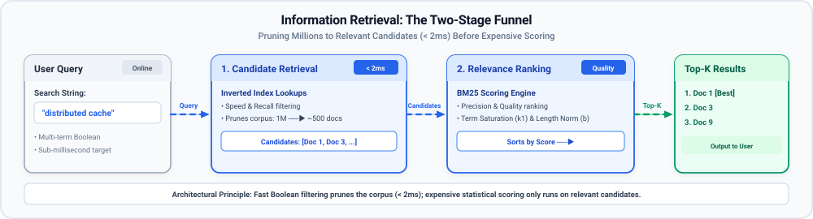
</p>

---

### Lab Objectives & Deliverables

By the end of this lab, you will have built:
1. A modular text analysis pipeline (`TextAnalyzer`) that tokenizes, normalizes, and filters text.
2. An in-memory inverted index (`InvertedIndex`) storing dictionary terms and sorted posting lists.
3. A two-pointer Boolean intersection algorithm that executes multi-term `AND` queries in linear time.
4. An Okapi BM25 ranking engine (`SearchRanker`) with term saturation and document length normalization, including an `explain_score()` tool modeled after Elasticsearch's `_explain` API.
5. A benchmark query log (`query_log.txt`) and human-scored relevance judgments (`relevance_judgments.json`) that will serve as our ground truth benchmark when comparing against Elasticsearch in **Module 16a Lab 3**.

---

## Core Concepts: How Search Engines Work Under the Hood

### 1. The Storage Problem: Forward Index vs. Inverted Index

To understand why search engines are designed the way they are, we must look at how computers naturally store text versus how search queries actually access text.

#### How Computers Naturally Store Data: The Forward Index
When you write an application that saves articles, blog posts, or database records, each item is assigned an identifier (like a primary key or document ID) and stored alongside its content.

In search engineering, this structure is known as a **Forward Index**.
* **Mapping Direction**: `Document ID ──▶ List of Words (Terms)`
* It answers the question: *"Given Document 2, what words are contained inside it?"*

To see this clearly, imagine we have a collection of three short technical documents:
* **Doc 1**: `"Redis is a distributed cache"`
* **Doc 2**: `"Raft consensus coordinates distributed servers"`
* **Doc 3**: `"Database sharding distributes data across cache servers"`

In a Forward Index, the data is organized exactly as it was written:

| Document ID | Title | Terms Contained in Document |
| :--- | :--- | :--- |
| **Doc 1** | In-Memory Caching | `[redis, distributed, cache]` |
| **Doc 2** | Consensus Protocols | `[raft, consensus, coordinates, distributed, servers]` |
| **Doc 3** | Database Partitioning | `[database, sharding, distributes, data, cache, servers]` |

#### Where is a Forward Index Used in Real Systems?
A forward index is the natural way storage engines work. You see forward indices in:
* **Relational Databases (PostgreSQL, MySQL)**: Storing table rows where each row ID maps to column text.
* **Document Databases (MongoDB, CouchDB)**: Storing BSON/JSON documents keyed by `_id`.
* **Search Snippet Generators**: Once a search engine identifies that Doc 1 is the best result, it uses a forward index to fetch Doc 1's title and generate a 2-line preview snippet for the user's screen.

#### The Breakdown of Forward Index for Searching
Now consider what happens when a user types the word `"distributed"` into a search box.

Using only a forward index, how does the system find matching documents?
1. It opens Doc 1 and scans its term list: `"distributed"` is found.
2. It opens Doc 2 and scans its term list: `"distributed"` is found.
3. It opens Doc 3 and scans its term list: `"distributed"` is not found (only `"distributes"`).

For three documents, this is trivial. But if you have 50 million documents, the computer must visit all 50 million entries sequentially. This is an `O(N)` full-table scan. When hundreds of users are searching concurrently, your storage layer collapses under disk I/O and CPU exhaustion.

---

#### The Inversion: The Inverted (Backward) Index
To make search fast, we need to invert the relationship. Instead of listing the words that belong to each document, we create an index that lists the documents that contain each word.

* **Mapping Direction**: `Term (Word) ──▶ List of Document IDs`
* It answers the question: *"Given the word 'cache', which documents contain it?"*

Think about a physical reference textbook. If you want to know what is covered in Chapter 4, you turn to the Table of Contents at the front of the book. The Table of Contents lists: `Chapter 4 ──▶ Topics A, B, C`. That is a Forward Index.

Now imagine you are debugging a production outage and need to find every page in that 800-page book that mentions `"deadlock"`. You would never start on page 1 and read every paragraph to the end. Instead, you flip straight to the alphabetical index at the very back of the book. You find the letter **D**, look up `"deadlock"`, and immediately see: `pages 42, 115, 203`. You flip directly to those pages in seconds.

That alphabetical index at the back of a textbook is an **Inverted Index**.

Here is what the Inverted Index looks like for our three sample documents:

| Term (Word) | Document Frequency (`DF`) | Posting List (`doc_id`, `tf`) |
| :--- | :--- | :--- |
| **cache** | 2 | `[(Doc 1, tf=1), (Doc 3, tf=1)]` |
| **consensus** | 1 | `[(Doc 2, tf=1)]` |
| **coordinates** | 1 | `[(Doc 2, tf=1)]` |
| **data** | 1 | `[(Doc 3, tf=1)]` |
| **database** | 1 | `[(Doc 3, tf=1)]` |
| **distributed** | 2 | `[(Doc 1, tf=1), (Doc 2, tf=1)]` |
| **distributes** | 1 | `[(Doc 3, tf=1)]` |
| **raft** | 1 | `[(Doc 2, tf=1)]` |
| **redis** | 1 | `[(Doc 1, tf=1)]` |
| **servers** | 2 | `[(Doc 2, tf=1), (Doc 3, tf=1)]` |
| **sharding** | 1 | `[(Doc 3, tf=1)]` |

Notice what happened:
When a user searches for `"distributed"`, the search engine does not scan any documents. It performs a single hash table or B-tree lookup on the term `"distributed"` and instantly retrieves the list `[Doc 1, Doc 2]`. The lookup time is `O(1)` relative to the number of documents in the collection!

#### Where are Inverted Indices Used in Real Systems?
* **Full-Text Search Engines**: Elasticsearch, OpenSearch, Apache Solr, Meilisearch, and Algolia.
* **Code Search in IDEs**: VS Code workspace search, GitHub Code Search, and Sourcegraph.
* **Message & Collaboration Platforms**: Slack, Discord, and Microsoft Teams past message search.
* **Operating System File Search**: macOS Spotlight and Windows Search indexers.

---

#### Side-by-Side Architectural Comparison

The following table summarizes the structural trade-offs between Forward and Inverted Indices:

| Architectural Dimension | Forward Index | Inverted Index |
| :--- | :--- | :--- |
| **Core Mapping** | `Document ID` ──▶ `Terms` | `Term` ──▶ `Document IDs (Postings)` |
| **Primary Question** | *"What words are inside this document?"* | *"Which documents contain this specific word?"* |
| **Search Time Complexity** | `O(N × L)` — Full collection scan across `N` documents | `O(1)` dictionary lookup + `O(L)` posting list traversal |
| **Ingestion / Write Cost** | Very fast (append new document to storage) | Requires tokenizing, updating vocabulary, and appending to posting lists |
| **Update / Deletion Cost** | Simple (overwrite or delete the document record) | Expensive (must touch every posting list containing the document's terms) |
| **Real-World Storage Example** | PostgreSQL row table, MongoDB collection, Lucene `.fdt` stored fields | Lucene inverted segments (`.tim`, `.tip`, `.doc`), Elasticsearch index |
| **Role in Modern Search Engines** | Generates search result titles, highlighted snippets, and document previews | Finds matching candidate documents and provides term frequencies for ranking |

---

### 2. Anatomy of an Inverted Index: The Lexicon & Posting Lists

An inverted index is not just a single giant list. Under the hood, it is constructed from two cooperating data structures: the **Lexicon** and the **Posting Lists**.

<p align="center">
  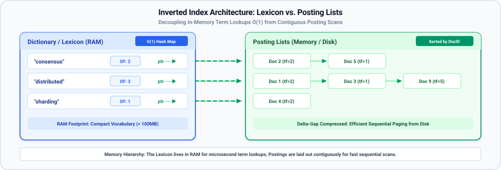
</p>

#### 1. The Lexicon (Dictionary / Vocabulary)
The Lexicon is the complete set of all unique words that exist across the entire document collection.
* In memory, it is typically implemented as a Hash Map, a Trie, or a Finite State Transducer (FST).
* For each term, the Lexicon stores two pieces of metadata:
  1. The **Document Frequency (`DF`)**: The total count of unique documents in which this term appears. This number is required by ranking formulas like TF-IDF and BM25.
  2. A pointer or memory reference to the beginning of the term's **Posting List**.

#### 2. The Posting Lists
For every term in the Lexicon, there is an associated list of entries called **postings**.
A single posting represents the occurrence of a term in one specific document. At a minimum, each posting records:
* `doc_id`: The integer identifier of the document containing the term.
* `term_frequency` (`TF`): How many times the term appears within that specific document.

In advanced commercial engines like Lucene, a posting can also store:
* `positions`: The exact zero-based word offsets where the term appears (needed to support exact phrase queries like `"distributed cache"`).
* `payloads`: Custom byte metadata attached to term positions (used for custom scoring boosts).

#### Why Posting Lists Must Be Strictly Sorted by Doc ID
In every production search engine, **posting lists are always kept strictly sorted in ascending order of `doc_id`**.

This is not an aesthetic choice; it is a critical algorithmic requirement:
1. **Sub-Millisecond Multi-Term Queries**: When a user searches for multiple words (e.g., `distributed AND consensus`), sorted lists allow us to find matching documents in a single linear pass using a **two-pointer scan**, without ever needing nested loops.
2. **High-Density Integer Compression**: Because document IDs are sorted integers (`12, 15, 18, 25`), engines do not store the raw numbers. Instead, they store the *differences* between numbers (`12, +3, +3, +7`). Small gap numbers require far fewer bits to store using algorithms like Elias-Fano, Variable Byte, or Roaring Bitmaps, allowing indices of millions of documents to fit in RAM.

---

### 3. The Text Analysis Pipeline: Preparing Raw Text for Search

Computers do not inherently understand human words; they only see sequences of byte values. If a user writes:
* In Document 1: `"Redis is fast!"`
* In Document 2: `"redis?"`
* In Document 3: `"REDIS"`

To a naive string comparator, these three words are completely different because their ASCII character values do not match. If a user searches for `redis`, they would fail to match Document 1 or Document 3.

To make text searchable, raw strings must pass through a multi-stage **Text Analysis Pipeline** before being indexed or queried.

<p align="center">
  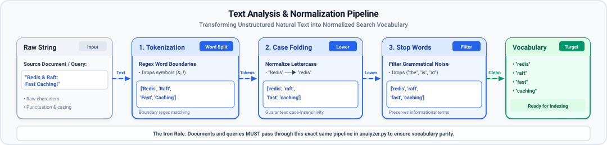
</p>

#### The Four Core Stages of Text Analysis

1. **Tokenization**:
   * *What it is*: Breaking a continuous stream of text characters into discrete semantic units called **tokens** (individual words).
   * *Why simple splitting fails*: Simply doing `text.split(" ")` in Python breaks immediately on punctuation: `"cache!"` becomes `["cache!"]`, with the exclamation mark attached. A search for `"cache"` will fail to match. A robust tokenizer uses regular expression word boundaries (`\b[a-zA-Z0-9_-]+\b`) or language-specific boundary detectors to isolate pure word tokens.

2. **Case Folding (Lowercasing)**:
   * *What it is*: Converting all characters to lowercase (`"Redis"` ──▶ `"redis"`, `"RAFT"` ──▶ `"raft"`).
   * *Why it matters*: Eliminates case sensitivity so that query casing never prevents a user from finding relevant information.

3. **Stop Word Removal**:
   * *What it is*: Filtering out ubiquitous grammatical filler words such as `"the"`, `"is"`, `"at"`, `"which"`, `"on"`, `"a"`, and `"and"`.
   * *Why we filter them*:
     1. *Memory bloat*: Stop words appear in almost every document. Their posting lists would contain nearly every document ID in the index, wasting massive amounts of RAM and disk space.
     2. *Zero discriminative value*: If a document contains the word `"the"`, that fact tells the search engine nothing about whether the document is about distributed caching, relational databases, or cooking recipes.
   * *The Engineering Trade-off*: Filtering stop words saves memory and speeds up queries, but it can break exact phrase queries where stop words matter (e.g., searching for the movie `"The Who"` or Shakespeare's phrase `"To be or not to be"`). Modern search engines often index stop words only when phrase searching or positional indexing is explicitly enabled.

4. **Stemming vs. Lemmatization**:
   * *The problem*: In natural language, words appear in various grammatical forms: `"cache"`, `"caches"`, `"cached"`, and `"caching"`. If an engineer searches for `"cache"`, they almost certainly want to match documents that discuss `"caching"`.
   * **Stemming**: A fast, heuristic rule-based approach that chops off common prefixes and suffixes. For example, the popular **Porter Stemmer** applies pattern rules to trim `-ing`, `-ed`, or `-s`. It is extremely fast and requires no vocabulary dictionary, but it can produce crude non-words (e.g., `"university"` and `"universal"` might both be trimmed to `"univers"`).
   * **Lemmatization**: A linguistically sophisticated approach that uses morphological analysis and a dictionary to resolve a word back to its true dictionary base form (known as the *lemma*). For example, lemmatization converts `"better"` ──▶ `"good"` and `"running"` ──▶ `"run"`. It is grammatically accurate but requires larger memory and higher CPU overhead.
   * *In this lab*: To keep our implementation clean, self-contained, and dependency-free, our `TextAnalyzer` implements regex tokenization, lowercasing, and stop word removal.

> **Important — The Iron Rule of Search Systems**:
> The documents and the search queries **must pass through the exact same analysis pipeline**.
> If documents are lowercased and stripped of punctuation when building the index, user queries must also be lowercased and stripped of punctuation at search time. If index time and query time use different analysis rules, the terms will never match, and search will silently fail.

---

### 4. Fast Candidate Retrieval: The Two-Pointer Intersection Algorithm

Once the inverted index is built, how does the engine execute a multi-word search query?

Suppose a user submits the Boolean query:
`Query: "distributed AND consensus"`

To resolve this query, the search engine:
1. Passes the query through `TextAnalyzer`, producing the tokens: `["distributed", "consensus"]`.
2. Looks up `"distributed"` in the Lexicon and retrieves its posting list:
   `List A = [1, 3, 7, 9, 15]`
3. Looks up `"consensus"` in the Lexicon and retrieves its posting list:
   `List B = [2, 3, 8, 9, 21]`

Now we must find the documents that appear in **both** lists (the set intersection `A ∩ B`).

#### Why Brute Force Fails
If our posting lists were unsorted, we would have to take each document in List A and compare it against every document in List B. That requires `O(LA × LB)` comparisons. If two lists have 100,000 documents each, brute force requires 10 billion comparisons!

#### The Two-Pointer Algorithm: Linear `O(LA + LB)` Merging
Because our posting lists are strictly sorted by `doc_id`, we can place a pointer at the start of both lists and advance them together in a single pass, exactly like the merge step in MergeSort:

<p align="center">
  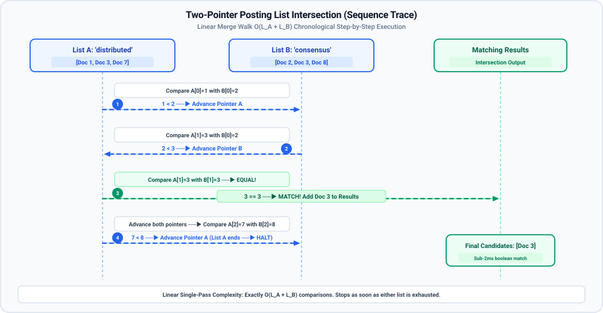
</p>

1. **Compare** the doc IDs at Pointer A and Pointer B:
   * If `Doc_A == Doc_B`: We found a match! Append the doc ID to our candidate list, and advance **both** pointers.
   * If `Doc_A < Doc_B`: List A is behind. Advance Pointer A to try to catch up.
   * If `Doc_B < Doc_A`: List B is behind. Advance Pointer B to try to catch up.
2. **Stop** as soon as either pointer reaches the end of its list.

By walking the lists simultaneously, the intersection finishes in at most `O(LA + LB)` operations. For two lists of 100,000 documents, the two-pointer scan takes at most 200,000 steps—running in less than 2 milliseconds!

---

### 5. Scoring Mechanics: Why Word Counts Fail & How BM25 Fixes Them

The two-pointer intersection solves the **Candidate Retrieval Problem**: it gives us the complete list of documents that contain all query terms.

However, in a real system with 10 million documents, a search for `"distributed cache"` might return 5,000 matching documents. No human user will read 5,000 documents. They expect the most relevant, high-quality document to appear at **Rank 1**.

This brings us to the second half of search: **Relevance Ranking**.

#### The Intuition: Term Frequency (TF) and Inverse Document Frequency (IDF)

To score how relevant a document is to a query, Information Retrieval relies on two fundamental statistical signals:

1. **Term Frequency (`TF`)**:
   * *What it measures*: How many times does the query term appear inside a specific document?
   * *The Intuition*: If Document 1 mentions `"cache"` 4 times, and Document 2 mentions `"cache"` only once, Document 1 is more likely to be focused on caching.

2. **Inverse Document Frequency (`IDF`)**:
   * *What it measures*: How rare or common is the query term across the entire collection?
   * *The Intuition*: Consider a two-word query: `"distributed paxos"`.
     * In a distributed systems library, the word `"distributed"` appears in 8 out of 9 documents. It is common and carries very little discriminative power.
     * The word `"paxos"` appears in only 1 document in the entire library. It is exceptionally rare.
   * If a document contains `"paxos"`, that single match is an enormous signal of topical relevance. A match on `"distributed"` is routine background noise.
   * **The Principle**: Rare words carry high informational surprise and receive high `IDF` weights; common words carry low surprise and receive low `IDF` weights.

---

#### The Fatal Flaws of Classic TF-IDF
The classic formula for relevance scoring, **TF-IDF**, simply multiplies term frequency by inverse document frequency:
```text
Score_TFIDF(D, Q) = Σ [ TF(t, D) * IDF(t) ]
```

While mathematically straightforward, Classic TF-IDF suffers from two severe flaws in production environments:

##### Flaw 1: Linear Term Frequency Scaling (The Keyword Stuffing Problem)
Under classic TF-IDF, if a document repeats a keyword 20 times, its score is 20 times higher than a document that mentions it once.
This linear scaling breaks down in reality:
* Does mentioning `"cache"` 20 times make a page 20 times more relevant than a page mentioning it twice? Of course not. In human language, term relevance exhibits **diminishing returns**.
* Worse, linear scaling invites **keyword stuffing**: a spammer can artificially inflate their rank simply by repeating keywords at the bottom of a web page.

##### Flaw 2: Document Length Bias (The Verbosity Problem)
A 50-page technical manual naturally contains more words than a concise 1-page engineering cheat sheet.
* Even if the 50-page manual is mostly about power supplies, cooling, and rack mounting, it will casually mention `"cache"` 6 or 7 times across its pages.
* The concise 1-page cheat sheet is 100% focused on caching, but only mentions the word 3 times.
* Because classic TF-IDF does not normalize for document length, **the long, rambling document always wins over the concise, highly relevant document**.

---

#### The Production Solution: Okapi BM25

To eliminate both flaws, modern search engines (including Apache Lucene, Elasticsearch, and Meilisearch) replaced TF-IDF with **Okapi BM25** (Best Matching 25).

Okapi BM25 introduces two tunable mathematical controls that fix the weaknesses of TF-IDF:

<p align="center">
  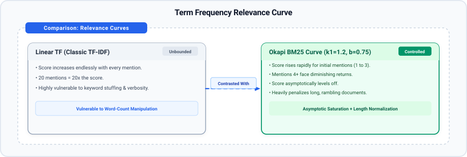
</p>

##### 1. Term Saturation (Controlled by parameter `k1`, typically 1.2)
Instead of scaling linearly, BM25 shapes term frequency into an asymptotic saturation curve:
* Moving from 0 mentions to 1 mention provides a large score boost.
* Moving from 1 mention to 2 mentions provides a moderate boost.
* Moving from 10 mentions to 20 mentions provides virtually no additional score benefit.
The score asymptotically approaches an upper limit of `(k1 + 1)`. This completely neutralizes keyword stuffing.

##### 2. Document Length Normalization (Controlled by parameter `b`, typically 0.75)
BM25 compares each document's length (`|D|`) against the **average document length** across the entire collection (`avgdl`):
```text
Length_Penalty = 1 - b + b * (|D| / avgdl)
```
* If a document is shorter than average (`|D| < avgdl`), the denominator shrinks, **boosting** the document's score because its keyword matches are concentrated and dense.
* If a document is 3 times longer than average (`|D| > avgdl`), the denominator grows, **penalizing** the document's score because its keywords are diluted amidst extraneous content.

> **Optional Deep Dive — The Formal BM25 Formula**:
>
> ```text
>                              TF(t, D) * (k1 + 1)
> Score(D, Q) = Σ  IDF(t) * ─────────────────────────────────────────
>               t           TF(t, D) + k1 * (1 - b + b * (|D| / avgdl))
>
> IDF(t) = ln( 1 + (N - DF(t) + 0.5) / (DF(t) + 0.5) )
> ```
>
> Where:
> * `TF(t, D)` is the frequency of term `t` in document `D`.
> * `IDF(t)` is Lucene's smoothed inverse document frequency.
> * `|D|` is document length, and `avgdl` is the average document length across the collection.
> * `k1` (default 1.2) controls term frequency saturation; `b` (default 0.75) controls document length normalization penalty.
>
> Do not let the formula intimidate you—in Step 6, we will write this in four clean lines of Python and see exactly how it flips the rankings to put the best document at the top!

---

### 6. End-to-End System Architecture

Before we start writing code, let us look at the high-level architecture of the search engine you are about to construct:

<p align="center">
  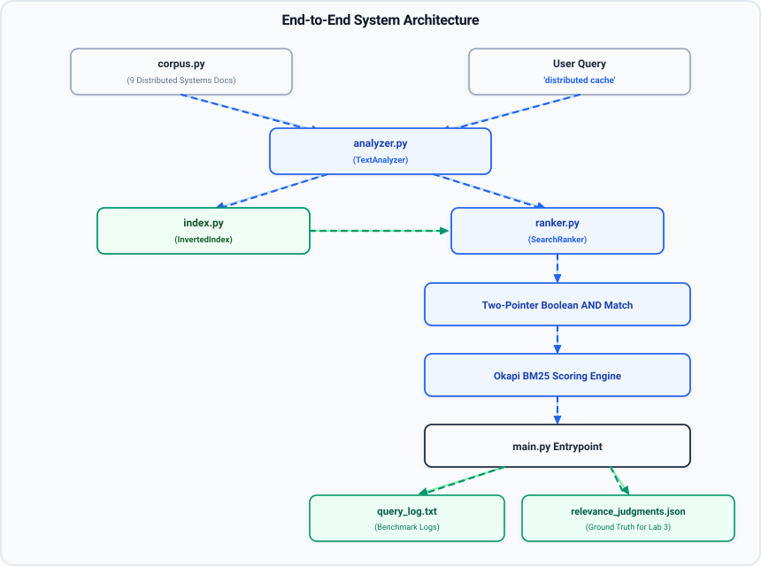
</p>

* **`corpus.py`**: Contains our seed collection of 9 realistic distributed systems engineering documents.
* **`analyzer.py`**: The `TextAnalyzer` class that performs tokenization, case folding, and stop word removal.
* **`index.py`**: The `InvertedIndex` class that maintains the Lexicon dictionary, sorted posting lists, and document length statistics (`avgdl`).
* **`ranker.py`**: The `SearchRanker` class that computes two-pointer Boolean `AND` intersections, classic TF-IDF, and Okapi BM25 scoring with an Elasticsearch-style `explain_score()` breakdown.
* **`main.py`**: The master orchestration script that indexes the corpus, demonstrates why BM25 flips the ranking to defeat verbosity, executes benchmark queries, and exports ground truth judgments.

---

## Step-by-Step Implementation

> **Caution — Learning Guidance**:
> Do not look at the solutions first. For each component, make an honest attempt to implement the `# TODO:` challenges on your own before seeking the solution. Struggling with the logic, indexing mechanics, and pointer algorithms is where true engineering intuition develops. Complete, verified solutions for every algorithm and step are fully provided immediately after each challenge block if you get stuck or want to verify your approach.

### Step 1: Workspace & Project Setup

In your terminal, navigate to your workspace and create the project directory:

```bash
mkdir -p inverted_index_lab
cd inverted_index_lab
touch corpus.py analyzer.py index.py ranker.py main.py
ls -la
```

<p align="center">
  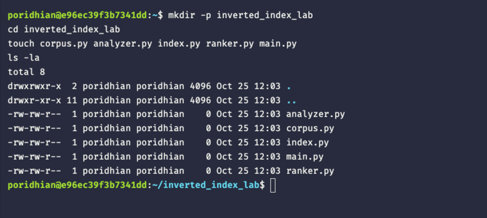
</p>

---

### Step 2: Creating the Seed Corpus (`corpus.py`)

Open `corpus.py` in your editor. We will seed our search engine with 9 realistic documents covering distributed systems.

Pay close attention to **Document 9**. It is intentionally written as a long, rambling infrastructure document that repeats the words `"distributed"` and `"cache"` multiple times among unrelated hardware chatter. This document will serve as our test case to prove why BM25 outperforms raw TF-IDF.

Write the following code into `corpus.py`:

```python
# corpus.py
"""
Sample Document Collection for the Inverted Index Lab.
Notice Document 9 is intentionally verbose with repeated keywords.
"""

DOCUMENTS = {
    1: {
        "title": "Distributed In-Memory Caching with Redis",
        "content": (
            "Redis is an in-memory key-value data store frequently deployed as a distributed cache. "
            "A distributed cache cluster accelerates read-heavy workloads with sub-millisecond latency. "
            "Redis cache instances support master-slave replication and automated key eviction policies."
        ),
    },
    2: {
        "title": "Raft Consensus and Leader Election",
        "content": (
            "The Raft consensus algorithm maintains state machine consistency across distributed servers. "
            "Nodes transition between follower, candidate, and leader states through randomized timers and "
            "heartbeat messages during leader election."
        ),
    },
    3: {
        "title": "Database Sharding and Horizontal Partitioning",
        "content": (
            "Database sharding divides a large dataset across multiple database instances horizontally. "
            "Selecting a high-cardinality partition key avoids hotspots and minimizes expensive "
            "cross-shard scatter-gather queries."
        ),
    },
    4: {
        "title": "Kafka Event Streaming and Partition Rebalancing",
        "content": (
            "Apache Kafka is a distributed event streaming platform organized into append-only partitioned logs. "
            "Consumer groups coordinate message processing and trigger partition rebalancing when worker "
            "instances fail or join."
        ),
    },
    5: {
        "title": "Consistent Hashing and Virtual Nodes",
        "content": (
            "Consistent hashing maps both servers and data keys onto a circular hash ring. "
            "Allocating multiple virtual nodes per physical machine prevents uneven cache data distribution "
            "when servers are added or removed."
        ),
    },
    6: {
        "title": "Distributed Transactions with Two-Phase Commit",
        "content": (
            "Two-phase commit coordinates atomic distributed transactions across heterogeneous databases. "
            "The central coordinator issues prepare and commit commands, ensuring all nodes commit or "
            "abort uniformly despite network partitions."
        ),
    },
    7: {
        "title": "Application Load Balancing with Nginx",
        "content": (
            "Reverse proxy load balancers distribute incoming client HTTP traffic across upstream application pools. "
            "Algorithms like least-connections and active health checks ensure high availability and graceful "
            "failure routing."
        ),
    },
    8: {
        "title": "Data Replication Strategies: Sync vs Async",
        "content": (
            "Storage systems balance durability and latency using synchronous or asynchronous replication. "
            "Synchronous replication guarantees zero data loss at the cost of write latency, whereas asynchronous "
            "replication provides eventual consistency."
        ),
    },
    9: {
        "title": "Rambling Infrastructure Notes on Hardware & Cache (Verbose Document)",
        "content": (
            "During our quarterly infrastructure architecture review, the team discussed hardware upgrades, "
            "rack cooling, power distribution, network switches, operating system kernels, and distributed cache deployment. "
            "When building a distributed cache, engineers must consider disk controllers, memory timing, thermal throttling, "
            "and network interface card bandwidth. A cache can store temporary session tokens, but cache invalidation "
            "remains notoriously difficult across data centers. If the distributed cache experiences packet loss, "
            "database connection pools spike and server response times degrade. Furthermore, we audited backup power supplies, "
            "fiber optic cables, and firewall rule configurations before testing the distributed cache cluster again. "
            "In summary, monitoring CPU utilization and distributed cache metrics is essential for data center reliability."
        ),
    },
}
```

---

### Step 3: Building the Text Analysis Engine (`analyzer.py`)

Open `analyzer.py`. We will build the `TextAnalyzer` class.

#### Your Challenge: Token Normalization
We extract raw words using regular expression word boundaries (`re.findall(r"\b[a-zA-Z0-9_-]+\b", text)`). Your task is to implement the `normalize` method to lowercase every token, strip out stop words, and eliminate single-character punctuation noise.

```python
# analyzer.py
import re


class TextAnalyzer:
    STOPWORDS = {
        "a", "an", "the", "and", "or", "in", "on", "at", "to", "for",
        "of", "with", "by", "from", "is", "are", "was", "were", "it",
        "this", "that", "these", "those", "into", "as", "be", "your",
        "we", "when", "all", "can", "if", "often", "where", "how"
    }

    def __init__(self, stopwords: set[str] | None = None):
        self.stopwords = stopwords if stopwords is not None else self.STOPWORDS

    def tokenize(self, text: str) -> list[str]:
        """Extracts words using regular expression word boundaries."""
        return re.findall(r"\b[a-zA-Z0-9_-]+\b", text)

    def normalize(self, tokens: list[str]) -> list[str]:
        # -----------------------------------------------------------------
        # TODO: Implement token normalization:
        # 1. Convert each token to lowercase.
        # 2. Exclude any token that is in self.stopwords.
        # 3. Exclude any single-character noise (len(token) > 1).
        #
        # Hint: Use a list comprehension:
        # [t.lower() for t in tokens if t.lower() not in self.stopwords and len(t) > 1]
        # -----------------------------------------------------------------
        pass

    def analyze(self, text: str) -> list[str]:
        raw_tokens = self.tokenize(text)
        return self.normalize(raw_tokens)
```

#### The Solution Walkthrough
Here is the completed `analyzer.py`:

```python
# analyzer.py (Completed)
import re


class TextAnalyzer:
    STOPWORDS = {
        "a", "an", "the", "and", "or", "in", "on", "at", "to", "for",
        "of", "with", "by", "from", "is", "are", "was", "were", "it",
        "this", "that", "these", "those", "into", "as", "be", "your",
        "we", "when", "all", "can", "if", "often", "where", "how"
    }

    def __init__(self, stopwords: set[str] | None = None):
        self.stopwords = stopwords if stopwords is not None else self.STOPWORDS

    def tokenize(self, text: str) -> list[str]:
        return re.findall(r"\b[a-zA-Z0-9_-]+\b", text)

    def normalize(self, tokens: list[str]) -> list[str]:
        return [
            token.lower()
            for token in tokens
            if token.lower() not in self.stopwords and len(token) > 1
        ]

    def analyze(self, text: str) -> list[str]:
        raw_tokens = self.tokenize(text)
        return self.normalize(raw_tokens)


if __name__ == "__main__":
    analyzer = TextAnalyzer()
    sample_text = "Redis is an in-memory, key-value distributed cache!"
    tokens = analyzer.analyze(sample_text)
    print(f"Sample Input:    '{sample_text}'")
    print(f"Analyzed Tokens: {tokens}")
```

#### Test It in Terminal:
```bash
python3 analyzer.py
```

<p align="center">
  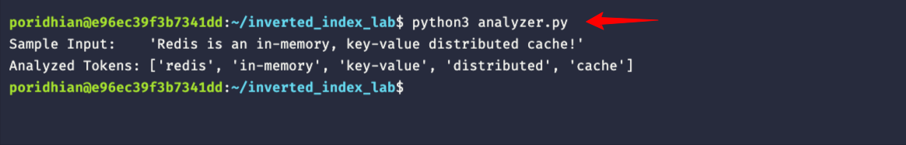
</p>


Notice that uppercase `Redis` became `redis`, stop words `is` and `an` were eliminated, and technical hyphenated words `in-memory` and `key-value` were preserved!

---

### Step 4: Constructing the Inverted Index Data Structure (`index.py`)

Open `index.py`. We will now build the `InvertedIndex` class.

#### Your Challenge: Posting List Population & Length Tracking
When a document is indexed:
1. Record its token count in `self.doc_lengths[doc_id]`.
2. Count the frequencies of each term using `Counter(tokens)`.
3. Append `(doc_id, freq)` into `self.dictionary[term]`.

```python
# index.py
from collections import Counter, defaultdict


class InvertedIndex:
    def __init__(self):
        # Maps term -> [(doc_id, tf), ...]
        self.dictionary: dict[str, list[tuple[int, int]]] = defaultdict(list)
        self.doc_lengths: dict[int, int] = {}
        self.total_docs: int = 0
        self.total_tokens: int = 0

    @property
    def avg_doc_len(self) -> float:
        if self.total_docs == 0:
            return 0.0
        return self.total_tokens / self.total_docs

    def add_document(self, doc_id: int, tokens: list[str]) -> None:
        # -----------------------------------------------------------------
        # TODO: Implement add_document logic:
        # 1. Update self.total_docs by 1.
        # 2. Record doc_len in self.doc_lengths[doc_id] and add to self.total_tokens.
        # 3. Use Counter(tokens) to find frequencies.
        # 4. Iterate over term, count: append (doc_id, count) to self.dictionary[term].
        # -----------------------------------------------------------------
        pass

    def get_postings(self, term: str) -> list[tuple[int, int]]:
        return self.dictionary.get(term, [])

    def get_doc_freq(self, term: str) -> int:
        return len(self.dictionary.get(term, []))

    def get_doc_len(self, doc_id: int) -> int:
        return self.doc_lengths.get(doc_id, 0)

    def vocabulary_size(self) -> int:
        return len(self.dictionary)
```

#### The Solution Walkthrough
Here is the completed `index.py`:

```python
# index.py (Completed)
from collections import Counter, defaultdict


class InvertedIndex:
    def __init__(self):
        self.dictionary: dict[str, list[tuple[int, int]]] = defaultdict(list)
        self.doc_lengths: dict[int, int] = {}
        self.total_docs: int = 0
        self.total_tokens: int = 0

    @property
    def avg_doc_len(self) -> float:
        if self.total_docs == 0:
            return 0.0
        return self.total_tokens / self.total_docs

    def add_document(self, doc_id: int, tokens: list[str]) -> None:
        doc_len = len(tokens)
        self.total_docs += 1
        self.total_tokens += doc_len
        self.doc_lengths[doc_id] = doc_len

        tf_counts = Counter(tokens)
        for term, freq in tf_counts.items():
            self.dictionary[term].append((doc_id, freq))

    def get_postings(self, term: str) -> list[tuple[int, int]]:
        return self.dictionary.get(term, [])

    def get_doc_freq(self, term: str) -> int:
        return len(self.dictionary.get(term, []))

    def get_doc_len(self, doc_id: int) -> int:
        return self.doc_lengths.get(doc_id, 0)

    def vocabulary_size(self) -> int:
        return len(self.dictionary)


if __name__ == "__main__":
    index = InvertedIndex()
    index.add_document(1, ["redis", "distributed", "cache"])
    index.add_document(2, ["raft", "consensus", "leader"])
    index.add_document(3, ["distributed", "raft", "cache"])

    print(f"Total documents: {index.total_docs}")
    print(f"Average document length: {index.avg_doc_len:.2f}")
    print(f"Postings for 'cache': {index.get_postings('cache')}")
    print(f"Postings for 'distributed': {index.get_postings('distributed')}")
```

#### Test It in Terminal:
```bash
python3 index.py
```

<p align="center">
  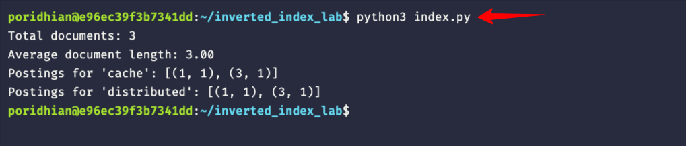
</p>


Notice how `self.dictionary['cache']` maps directly to `[(1, 1), (3, 1)]`. In one lookup, we know Doc 1 and Doc 3 mention `"cache"`!

---

### Step 5: Implementing Boolean Candidate Retrieval (`ranker.py`)

Open `ranker.py`. We will now implement the first half of our ranking engine: **Candidate Matching**.

#### Your Challenge: The Two-Pointer Intersection Loop
When searching for documents containing `term_A AND term_B`, we fetch their posting lists and find matching `doc_id`s in a single pass.

```python
# ranker.py (Snippet 1: Candidate Retrieval)
import math
from analyzer import TextAnalyzer
from index import InvertedIndex


class SearchRanker:
    def __init__(self, index: InvertedIndex, analyzer: TextAnalyzer):
        self.index = index
        self.analyzer = analyzer

    def intersect_two_postings(
        self, list_a: list[tuple[int, int]], list_b: list[tuple[int, int]]
    ) -> list[int]:
        """
        Computes Boolean AND intersection of two sorted posting lists in O(len(A) + len(B)).
        """
        p1 = 0
        p2 = 0
        matching_docs = []

        # -----------------------------------------------------------------
        # TODO: Implement the two-pointer intersection scan:
        # While p1 < len(list_a) and p2 < len(list_b):
        #   doc_a = list_a[p1][0]
        #   doc_b = list_b[p2][0]
        #   - If doc_a == doc_b: append to matching_docs, p1 += 1, p2 += 1
        #   - Elif doc_a < doc_b: p1 += 1
        #   - Else: p2 += 1
        # -----------------------------------------------------------------
        return matching_docs
```

#### The Solution Walkthrough
Here is how the completed intersection and candidate matching methods look:

```python
    def intersect_two_postings(
        self, list_a: list[tuple[int, int]], list_b: list[tuple[int, int]]
    ) -> list[int]:
        p1 = 0
        p2 = 0
        matching_docs = []

        while p1 < len(list_a) and p2 < len(list_b):
            doc_a = list_a[p1][0]
            doc_b = list_b[p2][0]

            if doc_a == doc_b:
                matching_docs.append(doc_a)
                p1 += 1
                p2 += 1
            elif doc_a < doc_b:
                p1 += 1
            else:
                p2 += 1

        return matching_docs

    def get_candidates(self, query_tokens: list[str]) -> list[int]:
        if not query_tokens:
            return []

        posting_lists = [self.index.get_postings(term) for term in query_tokens]

        # If any query term does not exist in the index, AND intersection is empty
        if any(len(p) == 0 for p in posting_lists):
            return []

        # Stanford CS276 Optimization: Intersect shortest lists first
        posting_lists.sort(key=len)

        candidates = [doc_id for doc_id, _ in posting_lists[0]]

        for next_postings in posting_lists[1:]:
            current_postings = [(doc_id, 0) for doc_id in candidates]
            candidates = self.intersect_two_postings(current_postings, next_postings)
            if not candidates:
                break

        return candidates
```

---

### Step 6: Building the Relevance Ranking Engine: TF vs. BM25 (`ranker.py`)

Now we implement the second half of `ranker.py`: scoring our candidates.

We implement:
1. `calculate_idf(term)`:
   ```text
   IDF(t) = ln( 1 + (N - DF + 0.5) / (DF + 0.5) )
   ```
2. `score_tf_idf(tokens, doc_id)`: Baseline linear scoring (`TF * IDF`).
3. `score_bm25(tokens, doc_id, k1=1.2, b=0.75)`: Production saturation and length-normalized scoring.
4. `explain_score(query, doc_id)`: Term-by-term breakdown tool.

#### The Complete `ranker.py` Code:

```python
# ranker.py (Full Completed File)
import math
from analyzer import TextAnalyzer
from index import InvertedIndex


class SearchRanker:
    def __init__(self, index: InvertedIndex, analyzer: TextAnalyzer):
        self.index = index
        self.analyzer = analyzer

    def intersect_two_postings(
        self, list_a: list[tuple[int, int]], list_b: list[tuple[int, int]]
    ) -> list[int]:
        p1 = 0
        p2 = 0
        matching_docs = []

        while p1 < len(list_a) and p2 < len(list_b):
            doc_a = list_a[p1][0]
            doc_b = list_b[p2][0]

            if doc_a == doc_b:
                matching_docs.append(doc_a)
                p1 += 1
                p2 += 1
            elif doc_a < doc_b:
                p1 += 1
            else:
                p2 += 1

        return matching_docs

    def get_candidates(self, query_tokens: list[str]) -> list[int]:
        if not query_tokens:
            return []

        posting_lists = [self.index.get_postings(term) for term in query_tokens]

        if any(len(p) == 0 for p in posting_lists):
            return []

        posting_lists.sort(key=len)
        candidates = [doc_id for doc_id, _ in posting_lists[0]]

        for next_postings in posting_lists[1:]:
            current_postings = [(doc_id, 0) for doc_id in candidates]
            candidates = self.intersect_two_postings(current_postings, next_postings)
            if not candidates:
                break

        return candidates

    def calculate_idf(self, term: str) -> float:
        doc_count = self.index.total_docs
        df = self.index.get_doc_freq(term)
        if df == 0 or doc_count == 0:
            return 0.0
        return math.log(1.0 + (doc_count - df + 0.5) / (df + 0.5))

    def _get_term_frequency(self, term: str, doc_id: int) -> int:
        for d_id, freq in self.index.get_postings(term):
            if d_id == doc_id:
                return freq
        return 0

    def score_tf_idf(self, query_tokens: list[str], doc_id: int) -> float:
        total_score = 0.0
        for term in query_tokens:
            tf = self._get_term_frequency(term, doc_id)
            idf = self.calculate_idf(term)
            total_score += tf * idf
        return total_score

    def score_bm25(
        self,
        query_tokens: list[str],
        doc_id: int,
        k1: float = 1.2,
        b: float = 0.75,
    ) -> float:
        total_score = 0.0
        doc_len = self.index.get_doc_len(doc_id)
        avg_len = self.index.avg_doc_len

        len_norm = 1.0 - b + b * (doc_len / avg_len) if avg_len > 0 else 1.0

        for term in query_tokens:
            tf = self._get_term_frequency(term, doc_id)
            if tf == 0:
                continue

            idf = self.calculate_idf(term)
            tf_norm = (tf * (k1 + 1.0)) / (tf + k1 * len_norm)
            total_score += idf * tf_norm

        return total_score

    def explain_score(
        self,
        query: str,
        doc_id: int,
        k1: float = 1.2,
        b: float = 0.75,
    ) -> dict:
        tokens = self.analyzer.analyze(query)
        doc_len = self.index.get_doc_len(doc_id)
        avg_len = self.index.avg_doc_len
        len_norm = 1.0 - b + b * (doc_len / avg_len) if avg_len > 0 else 1.0

        breakdown = {
            "doc_id": doc_id,
            "doc_len": doc_len,
            "avg_len": round(avg_len, 2),
            "len_ratio": round(doc_len / avg_len, 2) if avg_len > 0 else 1.0,
            "terms": [],
            "bm25_score": 0.0,
            "tfidf_score": 0.0,
        }

        bm25_total = 0.0
        tfidf_total = 0.0

        for term in tokens:
            tf = self._get_term_frequency(term, doc_id)
            idf = self.calculate_idf(term)
            tf_norm = (tf * (k1 + 1.0)) / (tf + k1 * len_norm) if tf > 0 else 0.0
            term_bm25 = idf * tf_norm
            term_tfidf = tf * idf

            bm25_total += term_bm25
            tfidf_total += term_tfidf

            breakdown["terms"].append({
                "term": term,
                "tf": tf,
                "idf": round(idf, 4),
                "tf_norm": round(tf_norm, 4),
                "bm25_contribution": round(term_bm25, 4),
                "tfidf_contribution": round(term_tfidf, 4),
            })

        breakdown["bm25_score"] = round(bm25_total, 4)
        breakdown["tfidf_score"] = round(tfidf_total, 4)
        return breakdown

    def search(
        self,
        query: str,
        mode: str = "bm25",
        top_k: int = 10,
        k1: float = 1.2,
        b: float = 0.75,
    ) -> list[tuple[int, float]]:
        tokens = self.analyzer.analyze(query)
        candidates = self.get_candidates(tokens)

        if not candidates:
            return []

        ranked_results = []
        for doc_id in candidates:
            if mode == "bm25":
                score = self.score_bm25(tokens, doc_id, k1=k1, b=b)
            elif mode == "tfidf":
                score = self.score_tf_idf(tokens, doc_id)
            else:
                raise ValueError(f"Unknown scoring mode: '{mode}'")

            ranked_results.append((doc_id, score))

        ranked_results.sort(key=lambda x: x[1], reverse=True)
        return ranked_results[:top_k]
```

---

### Step 7: Master Pipeline Execution & Relevance Judgments (`main.py`)

Open `main.py`. This script connects all modules:
1. Ingests all 9 documents.
2. Demonstrates the **Ranking Flip** between TF-IDF and Okapi BM25 for the query `"distributed cache"`.
3. Runs 5 standard benchmark queries and exports `query_log.txt`.
4. Hand-scores human relevance judgments (0, 1, 2) and exports `relevance_judgments.json`.

Write the following code into `main.py`:

```python
# main.py
"""
Master Search Engine Pipeline and Evaluation Runner.
"""

import json
from analyzer import TextAnalyzer
from corpus import DOCUMENTS
from index import InvertedIndex
from ranker import SearchRanker


def build_search_engine():
    analyzer = TextAnalyzer()
    index = InvertedIndex()

    print("=" * 70)
    print("STEP 1: Indexing Document Collection")
    print("=" * 70)

    for doc_id, doc_data in DOCUMENTS.items():
        tokens = analyzer.analyze(doc_data["content"])
        index.add_document(doc_id, tokens)
        print(f"  [Indexed] Doc {doc_id:02d}: '{doc_data['title']}' ({len(tokens)} tokens)")

    print("-" * 70)
    print(f"Corpus Statistics:")
    print(f"  • Total Documents:     {index.total_docs}")
    print(f"  • Vocabulary Size:      {index.vocabulary_size()} unique terms")
    print(f"  • Average Doc Length:   {index.avg_doc_len:.2f} tokens")
    print("=" * 70)

    ranker = SearchRanker(index, analyzer)
    return analyzer, index, ranker


def demonstrate_ranking_flip(ranker: SearchRanker):
    test_query = "distributed cache"
    print("\n" + "=" * 70)
    print("STEP 2: The Ranking Demonstration (TF-IDF vs. Okapi BM25)")
    print(f"Query: '{test_query}'")
    print("=" * 70)

    # 1. TF-IDF Ranking
    tfidf_results = ranker.search(test_query, mode="tfidf", top_k=5)
    print("\n--- Mode A: Classic TF-IDF Scoring ---")
    print("Rank | Doc ID | Score   | Title")
    print("-----+--------+---------+----------------------------------------------")
    for rank, (doc_id, score) in enumerate(tfidf_results, start=1):
        title = DOCUMENTS[doc_id]["title"]
        print(f"  {rank}  | Doc {doc_id:02d} | {score:7.4f} | {title}")

    # 2. Okapi BM25 Ranking
    bm25_results = ranker.search(test_query, mode="bm25", top_k=5)
    print("\n--- Mode B: Okapi BM25 Scoring (k1=1.2, b=0.75) ---")
    print("Rank | Doc ID | Score   | Title")
    print("-----+--------+---------+----------------------------------------------")
    for rank, (doc_id, score) in enumerate(bm25_results, start=1):
        title = DOCUMENTS[doc_id]["title"]
        print(f"  {rank}  | Doc {doc_id:02d} | {score:7.4f} | {title}")

    # 3. Explain Score Inspection
    print("\n--- Term-by-Term Score Explanation (Elasticsearch _explain style) ---")
    exp_doc1 = ranker.explain_score(test_query, 1)
    exp_doc9 = ranker.explain_score(test_query, 9)

    print(f"\nDoc 1 (length={exp_doc1['doc_len']}, len_ratio={exp_doc1['len_ratio']}):")
    for t in exp_doc1["terms"]:
        print(f"  • term '{t['term']}': tf={t['tf']}, idf={t['idf']}, tf_norm={t['tf_norm']} -> BM25 contribution={t['bm25_contribution']}")
    print(f"  => Total BM25: {exp_doc1['bm25_score']} | Total TF-IDF: {exp_doc1['tfidf_score']}")

    print(f"\nDoc 9 (length={exp_doc9['doc_len']}, len_ratio={exp_doc9['len_ratio']}):")
    for t in exp_doc9["terms"]:
        print(f"  • term '{t['term']}': tf={t['tf']}, idf={t['idf']}, tf_norm={t['tf_norm']} -> BM25 contribution={t['bm25_contribution']}")
    print(f"  => Total BM25: {exp_doc9['bm25_score']} | Total TF-IDF: {exp_doc9['tfidf_score']}")
    print("=" * 70)


def run_benchmark_queries(ranker: SearchRanker):
    benchmark_queries = [
        "distributed cache replication",
        "raft consensus leader election",
        "database sharding partition key",
        "kafka event streaming partition",
        "consistent hashing virtual nodes",
    ]

    log_lines = []
    log_lines.append("======================================================================")
    log_lines.append("INVERTED INDEX ENGINE: BENCHMARK QUERY LOG")
    log_lines.append("======================================================================\n")

    print("\n" + "=" * 70)
    print("STEP 3: Running 5 Benchmark Queries")
    print("=" * 70)

    for i, query in enumerate(benchmark_queries, start=1):
        results = ranker.search(query, mode="bm25", top_k=5)
        header = f"Query {i}: '{query}'"
        print(f"\n{header}")
        log_lines.append(header)
        log_lines.append("-" * 70)

        if not results:
            msg = "  No matching documents found."
            print(msg)
            log_lines.append(msg)
        else:
            for rank, (doc_id, score) in enumerate(results, start=1):
                title = DOCUMENTS[doc_id]["title"]
                line = f"  Rank {rank}: Doc {doc_id:02d} [BM25: {score:.4f}] - {title}"
                print(line)
                log_lines.append(line)

        log_lines.append("")

    with open("query_log.txt", "w", encoding="utf-8") as f:
        f.write("\n".join(log_lines))

    print("\n[Saved] Query log exported to: query_log.txt")


def generate_relevance_judgments():
    relevance_data = {
        "metadata": {
            "module": "M16a",
            "lab": "M16a-L1",
            "purpose": "Ground truth relevance judgments for search evaluation and Elasticsearch comparison in M16a-L3",
            "scale": {
                "0": "Irrelevant - Document does not address the query information need.",
                "1": "Partially Relevant - Document touches on the topic or related concepts.",
                "2": "Highly Relevant - Document directly answers or centers on the query topic."
            }
        },
        "queries": [
            {
                "query_id": "Q1",
                "query": "distributed cache replication",
                "expected_top_docs": [1, 8, 9],
                "judgments": [
                    {"doc_id": 1, "grade": 2, "notes": "Highly relevant: Directly covers Redis as a distributed cache with master-slave replication."},
                    {"doc_id": 8, "grade": 1, "notes": "Partially relevant: Explains synchronous vs asynchronous replication, but not caching."},
                    {"doc_id": 9, "grade": 1, "notes": "Partially relevant: Mentions distributed cache repeatedly, but rambling/noisy."}
                ]
            },
            {
                "query_id": "Q2",
                "query": "raft consensus leader election",
                "expected_top_docs": [2],
                "judgments": [
                    {"doc_id": 2, "grade": 2, "notes": "Highly relevant: Specifically explains Raft consensus states and leader election timers."},
                    {"doc_id": 6, "grade": 1, "notes": "Partially relevant: Covers distributed transactions, but not Raft consensus."}
                ]
            },
            {
                "query_id": "Q3",
                "query": "database sharding partition key",
                "expected_top_docs": [3],
                "judgments": [
                    {"doc_id": 3, "grade": 2, "notes": "Highly relevant: Core focus on horizontal sharding, partition keys, and avoiding hotspots."},
                    {"doc_id": 5, "grade": 1, "notes": "Partially relevant: Discusses consistent hashing key mapping, but for cache nodes."}
                ]
            },
            {
                "query_id": "Q4",
                "query": "kafka event streaming partition",
                "expected_top_docs": [4],
                "judgments": [
                    {"doc_id": 4, "grade": 2, "notes": "Highly relevant: Directly covers Apache Kafka event streaming and partitioned logs."},
                    {"doc_id": 3, "grade": 1, "notes": "Partially relevant: Mentions partitioning, but in relational databases."}
                ]
            },
            {
                "query_id": "Q5",
                "query": "consistent hashing virtual nodes",
                "expected_top_docs": [5],
                "judgments": [
                    {"doc_id": 5, "grade": 2, "notes": "Highly relevant: Dedicated document explaining consistent hashing and virtual node distribution."},
                    {"doc_id": 1, "grade": 1, "notes": "Partially relevant: Covers caching, but not consistent hashing ring geometry."}
                ]
            }
        ]
    }

    with open("relevance_judgments.json", "w", encoding="utf-8") as f:
        json.dump(relevance_data, f, indent=2)

    print("[Saved] Relevance judgments exported to: relevance_judgments.json")


def main():
    analyzer, index, ranker = build_search_engine()
    demonstrate_ranking_flip(ranker)
    run_benchmark_queries(ranker)
    generate_relevance_judgments()
    print("\n" + "=" * 70)
    print("ALL STEPS COMPLETED SUCCESSFULLY!")
    print("=" * 70)


if __name__ == "__main__":
    main()
```

#### Run the Master Pipeline:
```bash
python3 main.py
```

<p align="center">
  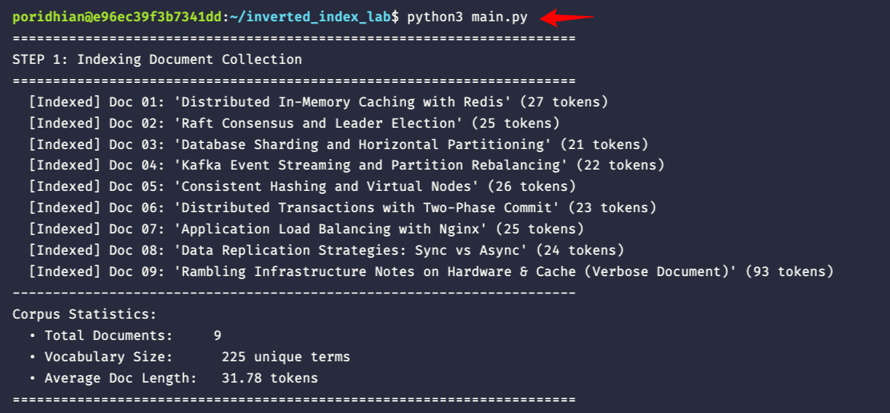
</p>
<p align="center">
  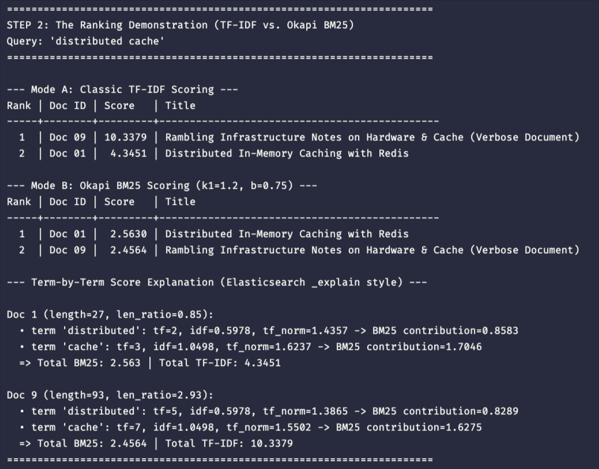
</p>
<p align="center">
  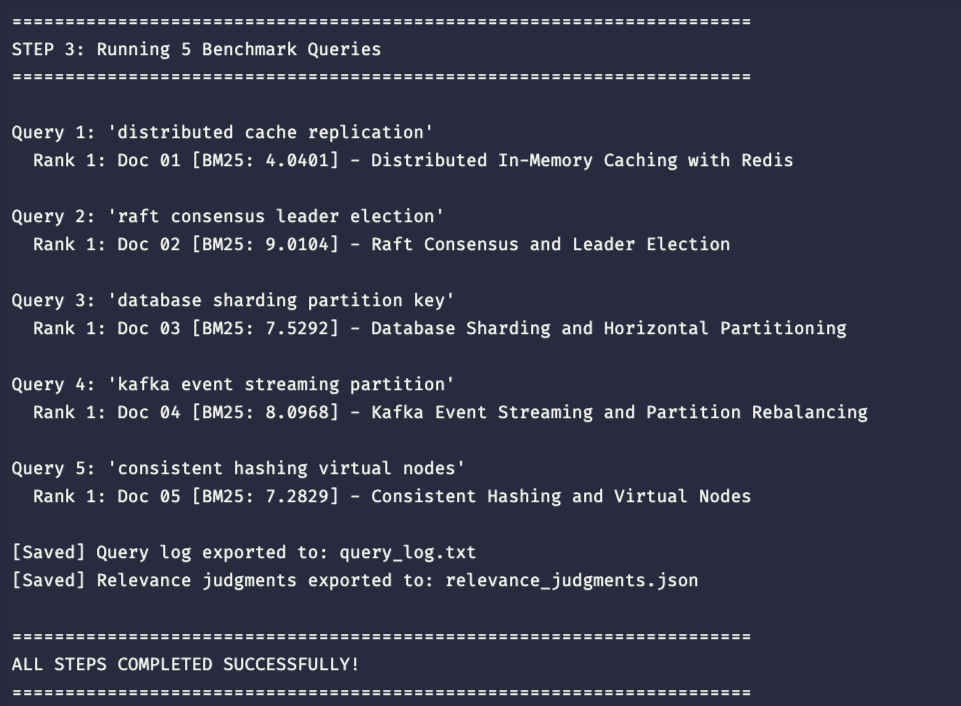
</p>


---

### Understanding the Results: Why the Ranking Flipped!

Look closely at the numbers from Step 2:

1. **Under Classic TF-IDF**:
   * Doc 9 scored **10.3379**, beating Doc 1 (**4.3451**) by more than 2x.
   * *Why?* Because Doc 9 mentioned `"cache"` 7 times and `"distributed"` 5 times. Classic TF-IDF linearly multiplied those counts without caring that Doc 9 was a rambling meeting note.
2. **Under Okapi BM25**:
   * **The Ranking Flipped!** Doc 1 took **Rank 1 (Score 2.5630)**, and Doc 9 was demoted to **Rank 2 (Score 2.4564)**.
   * *Why?* Look at the `explain_score()` data:
     * **Length Ratio**: Doc 1 is 27 tokens (`len_ratio = 0.85` of average), while Doc 9 is 93 tokens (`len_ratio = 2.93` of average).
     * **Length Normalization (`b = 0.75`)**: Doc 9 was heavily penalized for being nearly 3x longer than average.
     * **Term Saturation (`k1 = 1.2`)**: In Doc 9, despite having 7 mentions of `"cache"`, its normalized TF capped out at 1.55, whereas Doc 1 with only 3 mentions got a normalized TF of 1.62 because its keyword density was much higher.
   * **The Takeaway**: BM25 rewarded the concise, highly-focused engineering document over the verbose document. This is why BM25 has been the default ranking algorithm in Apache Lucene and Elasticsearch for over a decade.

---

## Frequently Asked Questions (FAQs)

### FAQ 1: Why not just use SQL `LIKE '%term%'` or regex grep for search?
Scanning raw text requires an `O(N × L)` sequential scan. For 10 million documents, the CPU must open every document, read its bytes into memory, and scan every character. An Inverted Index precomputes the mapping ahead of time: looking up a term is an `O(1)` dictionary lookup followed by reading a precomputed list of document IDs. Queries resolve in under 1 millisecond regardless of whether the collection has 10,000 or 100,000,000 documents.

### FAQ 2: Why must posting lists be strictly sorted by DocID?
If posting lists were unsorted, computing a multi-term Boolean `AND` intersection between two lists of length `L1` and `L2` would take `O(L1 × L2)` comparisons (comparing every element against every other element). Because they are sorted, we can use the **two-pointer linear merge algorithm**, finding the intersection in `O(L1 + L2)` time with a single pass through memory. Furthermore, sorted integers compress extremely well using Delta (gap) encoding (e.g. Roaring Bitmaps), drastically reducing RAM usage.

### FAQ 3: Why did Apache Lucene replace TF-IDF with Okapi BM25?
Classic TF-IDF scales linearly with term count and lacks proper document length normalization. This made it vulnerable to two major problems: keyword stuffing (unscrupulous documents repeating terms) and verbosity bias (long encyclopedic articles beating short, focused answers). Lucene switched to BM25 in version 6.0 because its `k1` term saturation and `b` length normalization consistently produce superior search relevance across virtually all text domains.

### FAQ 4: What happens if a query word appears in 100% of documents in the index?
In BM25, when a term appears in all `N` documents (`DF = N`):
```text
IDF(t) = ln( 1 + (N - N + 0.5) / (N + 0.5) )
       = ln( 1 + 0.5 / (N + 0.5) )
       ≈ ln(1 + 0) = 0
```
Its IDF score drops almost to zero. This means that words ubiquitous across the collection contribute almost nothing to the final ranking score. The ranking is instead decided by the rarer, more discriminative terms in the query.

### FAQ 5: How do production engines update inverted indices without taking down read traffic?
Inverted indices are immutable once written to disk (segments in Lucene). When new documents arrive, the engine does not rewrite the existing index; it buffers new documents in memory and flushes them as a **new, independent index segment**. Background threads periodically merge smaller segments into larger ones (Segment Merging). Deletions are handled via a tombstone bitmap, filtering out deleted Doc IDs at query time.

### FAQ 6: Why does Elasticsearch compute BM25 per-shard, and how does that affect small datasets?
In a distributed cluster, Elasticsearch splits an index into multiple primary shards (independent Lucene indices). By default, each shard calculates its own local IDF and average document length based only on the documents stored on that shard. On massive datasets, documents distribute evenly and scores converge. But on tiny test datasets (like our 9 documents), documents on different shards will produce skewed, inconsistent scores! To fix this on small datasets, engineers must set `number_of_shards: 1` or query with `?search_type=dfs_query_then_fetch` (Distributed Frequency Search).

---

## Situational Challenge Scenarios

### Scenario A: Non-Whitespace Delimited Languages (CJK)
* **The Problem**: You are tasked with expanding your search engine to index Japanese or Chinese documents. In Japanese, text like `"分散キャッシュシステム"` (distributed cache system) contains no spaces between words. Our regex `\w+` will treat the entire sentence as a single gigantic token, breaking search.
* **The Engineering Fix**: You must replace the simple regex tokenizer with a dictionary-based or statistical morphological analyzer (such as MeCab, Kuromoji, or Jieba). These analyzers use hidden Markov models (HMMs) or conditional random fields (CRFs) to identify word boundaries across continuous character streams before indexing.

### Scenario B: Exact Phrase Queries (`"distributed cache"`)
* **The Problem**: A user searches for `"distributed cache"` in quotation marks. They only want documents where `"distributed"` is immediately followed by `"cache"` in that exact sequence, not documents where the words appear in different paragraphs.
* **The Engineering Fix**: In our lab, postings only stored `(doc_id, tf)`. To support phrase queries, the posting list must be expanded to store **token positions**: `(doc_id, tf, [pos_1, pos_2, ...])`. During intersection, if Doc 1 has `"distributed"` at position 7, the engine checks if `"cache"` appears at position 8. If `pos_b == pos_a + 1`, the phrase matches!

### Scenario C: Extreme Document Length Disparity
* **The Problem**: Your corpus contains 20-word customer reviews and 10,000-word technical engineering specifications. Users complain that technical specifications never appear in search results because BM25's length normalization (`b = 0.75`) penalizes them too harshly for being long.
* **The Engineering Fix**: Technical specifications are long because they are detailed, not because they are rambling. In this scenario, decrease parameter `b` from 0.75 down to 0.3 or 0.2. Reducing `b` decreases the penalty applied to long documents, leveling the playing field for comprehensive technical documentation.

### Scenario D: Memory vs. Disk Trade-off (Index Scale)
* **The Problem**: Your corpus grows from 9 documents to 50,000,000 documents. The lexicon dictionary and posting lists no longer fit into RAM.
* **The Engineering Fix**: Production engines do not keep the entire posting list in memory. They store the posting lists on disk, sequentially block-compressed using variable-byte encoding or Roaring Bitmaps. The lexicon terms are stored in an in-memory **Finite State Transducer (FST)** or B-Tree, which points to byte offsets on disk. At query time, the engine seeks directly to the required byte offset on disk and reads only the relevant posting blocks into memory.

---

## What's Next: The Bridge to Typeahead & Autocomplete (Lab 2)

Congratulations on building a working inverted index and ranking engine! Before we finish, let us look ahead to **Module 16a Lab 2 (Typeahead Service with a Trie)**.

Notice an important limitation of what we built today:
1. **Inverted indices are built for complete words**: Our `TextAnalyzer` breaks text on word boundaries. It is exceptional when a user types `"distributed"`.
2. **Users type character-by-character**: When a user types into a modern search box, they start with `"d"`, then `"di"`, then `"dis"`, then `"dist"`.
3. **Why the inverted index collapses on typeahead**: To answer `"dis*"` using an inverted index, the engine must scan its entire dictionary for every word starting with `"dis"`, fetch hundreds of posting lists, union them, and rank them—all within **50 milliseconds** between keystrokes!

In **Lab 2**, we will solve this exact latency challenge. We will step away from inverted indices and introduce **Prefix Trees (Tries / Radix Trees)** and **Redis sorted sets**. You will build an autocomplete service capable of returning the top-K suggestions by frequency in under **50 ms** under 10,000 queries per second!

---

## Conclusion

### What You Built
* [x] **`corpus.py`**: A 9-document seed collection covering distributed systems concepts.
* [x] **`analyzer.py`**: An object-oriented `TextAnalyzer` that lowercases, tokenizes, and removes stop words.
* [x] **`index.py`**: An `InvertedIndex` maintaining an in-memory dictionary, sorted posting lists, and document length metadata (`avgdl`).
* [x] **`ranker.py`**: A `SearchRanker` that computes linear two-pointer Boolean `AND` intersections, classic TF-IDF, and Okapi BM25 scoring with `explain_score()` transparency.
* [x] **`main.py`**: An automated pipeline that builds the engine, proves the TF vs. BM25 ranking flip, and executes benchmark queries.
* [x] **`query_log.txt`**: The recorded execution output of our 5 benchmark queries.
* [x] **`relevance_judgments.json`**: Ground truth human-evaluated relevance grades (0, 1, 2) that we will import and test against Elasticsearch in **Module 16a Lab 3**.
