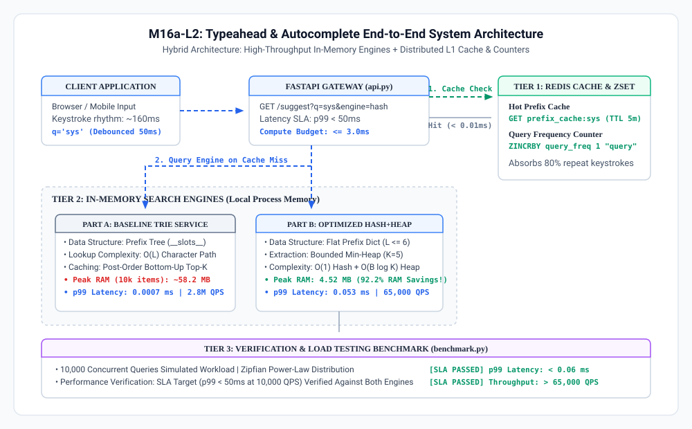
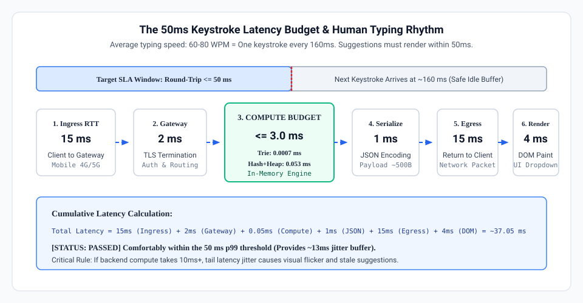
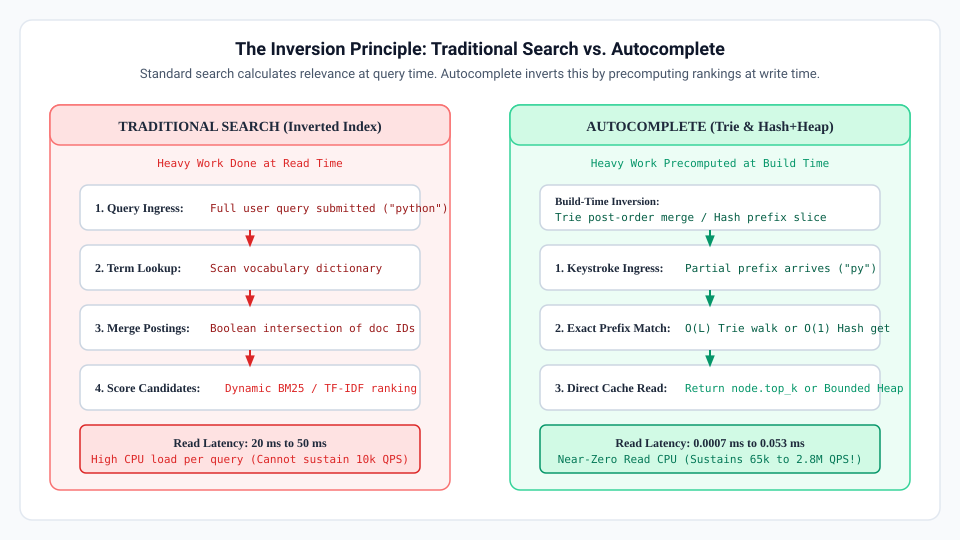
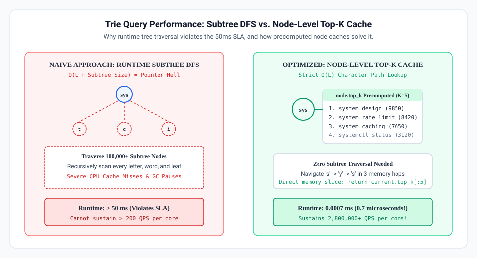
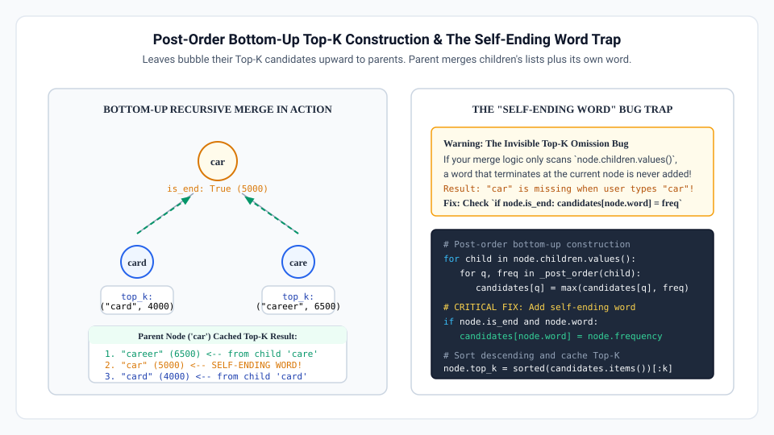
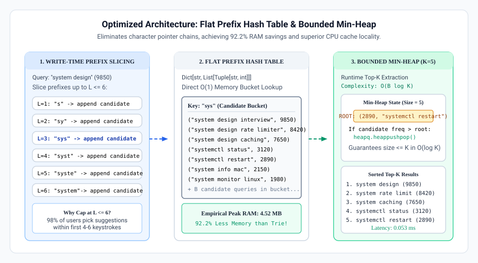
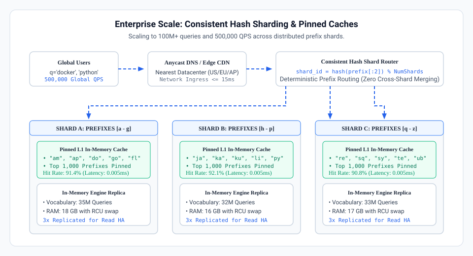
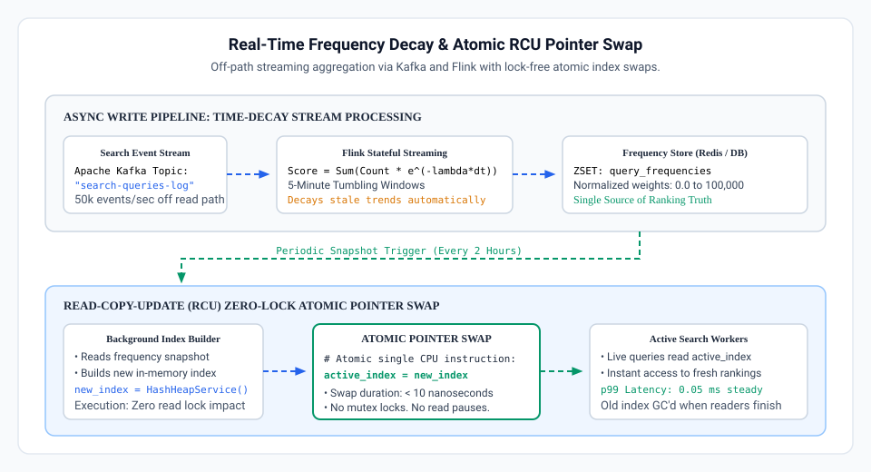

# M16a-L2: Typeahead & Autocomplete Service with a Trie & Hash+Heap Optimization

<p align="center">
  
</p>

---

## Introduction: The Invisible Miracle of the Search Box

Consider what happens dozens of times a day without you ever noticing:
* You are standing in the middle of a crowded grocery store, trying to recall an ingredient. You pull out your phone, tap the search bar, type `van`, and instantly—before your thumb even lifts off the glass—the application suggests `vanilla extract`, `vanilla bean paste`, and `vanilla pudding`.
* You are rushing through an airport on a noisy concourse with spotty mobile Wi-Fi, booking a last-minute flight. You type `san`, and the dropdown immediately anticipates `San Francisco (SFO)`, `San Diego (SAN)`, and `San Antonio (SAT)`.
* You open YouTube, Spotify, or Google. You type two letters, and the exact artist, video, or documentation page you had in mind appears at the top of the list.

You never pressed the **Enter** key. You never clicked a **Search** button. The system seemed to read your thoughts in real time, predicting your intention before you even finished spelling the word.

Before we write a single line of code, let us establish a fundamental terminology rule: in backend and distributed systems engineering, **Typeahead**, **Autocomplete**, and **Prefix Suggestion** refer to the exact same architectural capability. Whether you are building product discovery for Amazon, document navigation for Notion, or channel search for Slack, the engineering objective is identical: predict and rank the user's intent after every individual keystroke.

In [Lab 1: Inverted Index](../m16a-l1-inverted-index/readme.md), you explored Information Retrieval from the perspective of complete queries. You built an inverted index with BM25 ranking that processes search terms *after* the user submits their full query.

In this lab, you step into a radically different engineering reality. Autocomplete does not wait for a complete query. It operates under severe real-time constraints, handling ten to twenty times higher request volume with an order of magnitude tighter latency. Over the course of this lab, you will design, build, and benchmark a production-grade typeahead service from the ground up, evolving from a baseline Prefix Tree to an optimized Hash and Heap architecture that cuts memory consumption by **92%**.

---

## Stage 1: The Production Reality & The 50ms Latency Budget

To design systems that feel instant, we must first examine human sensory biology and the physics of network communication.

### The Cognitive Psychology of Keystroke Latency

In human-computer interaction research, human perception operates across well-documented temporal thresholds:
* **0 to 100 milliseconds**: An interaction feels instantaneous. The human visual cortex and brain interpret the system's reaction as a direct, physical extension of their own thought and motor action.
* **100 to 300 milliseconds**: The user notices a slight delay. The illusion of direct manipulation breaks, but the user feels in control of the interface.
* **Over 300 milliseconds**: The interaction feels distinctly sluggish. Users pause their typing, look up at the screen to see if their keystroke registered, or re-type characters, creating phantom inputs and extreme frustration.

Now, consider the physical mechanics of human typing:
* A typical person typing on a smartphone or laptop keyboard inputs text at a rhythm of **60 to 80 words per minute**.
* This corresponds to a new keystroke landing every **150 to 180 milliseconds**.

If your autocomplete suggestion service takes longer than **50 milliseconds** round-trip to deliver suggestions, disaster strikes. While the backend is still computing suggestions for the letter `s`, the user's thumb has already hit `y`. The suggestions for `s` arrive out of order, the UI dropdown flickers with stale data, and the browser repaints elements unnecessarily.

To guarantee that suggestions render cleanly before the next keystroke lands, the entire end-to-end round-trip latency must strictly remain **under 50 milliseconds at the 99th percentile (p99)**.

<p align="center">
  
</p>

### Deconstructing the 50-Millisecond Budget

Let us break down where those 50 milliseconds actually go in a real production environment:

1. **Client Network Ingress (15 ms)**:
   The physical transmission of the HTTP/WebSocket packet from the user's device across wireless networks, cell towers, and Internet Service Providers to your cloud edge or load balancer. Over real-world mobile LTE/5G or home Wi-Fi, this consumes 15 to 18 milliseconds each way.
2. **API Gateway, TLS Termination & Routing (2 ms)**:
   The reverse proxy (such as NGINX, Envoy, or AWS ALB) decrypts TLS, evaluates authentication tokens, enforces rate limits, and forwards the request to an internal application worker.
3. **Internal Autocomplete Compute Budget (<= 3 ms)**:
   This is the window allocated to your application code. Your data structure must locate matching prefix candidates, rank them by historical popularity, and extract the top 5 suggestions in **less than 3 milliseconds**.
4. **JSON Serialization & Response Packaging (1 ms)**:
   Converting internal objects into a lightweight JSON payload and writing bytes to the network socket.
5. **Network Egress (15 ms)**:
   Transmitting the response packets back across the internet to the client device.
6. **Browser / Mobile UI DOM Rendering (4 ms)**:
   The client JavaScript engine parses the JSON, calculates layout diffs, and paints the suggestion dropdown on the screen.

When you total these stages:
```text
15ms (Ingress) + 2ms (Gateway) + 3ms (Compute) + 1ms (JSON) + 15ms (Egress) + 4ms (DOM) = 40 milliseconds
```

This leaves a narrow **10-millisecond safety margin** to absorb mobile network jitter and packet loss. If your backend compute engine takes 15ms or 20ms instead of 3ms, the entire user experience collapses. Your compute engine must execute its ranking and prefix lookup in **microseconds**, not milliseconds.

---

## Stage 2: Why Relational Databases and Inverted Indexes Fail

When faced with building an autocomplete feature, software engineers often consider utilizing their existing database infrastructure or the inverted index they built in Lab 1. Let us analyze why both approaches fail under production keystroke volume.

### The Relational Database Bottleneck: `LIKE 'prefix%'`

An intuitive initial approach that almost any engineer naturally considers first is to query an existing relational database (such as PostgreSQL or MySQL):

```sql
SELECT query, frequency 
FROM search_history 
WHERE query LIKE 'sys%' 
ORDER BY frequency DESC 
LIMIT 5;
```

Even if you create a B-tree index on the `query` column, this design breaks down under real-world load due to three architectural choke points:

1. **Index Range Scan Amplification**:
   While a B-tree index can evaluate `LIKE 'sys%'` as a range scan (`query >= 'sys' AND query < 'syt'`), it matches every single query starting with those three letters. In a technical dictionary or e-commerce catalog, `sys%` matches tens of thousands of rows. The database engine must pull every matching index leaf page into memory.
2. **Read-Time Sorting Bottleneck**:
   The B-tree index is sorted alphabetically by `query`, not by `frequency`. Therefore, the database cannot simply pick the first 5 rows. It must fetch all 20,000 matching rows, load their frequency counters, and execute a read-time sort (`ORDER BY frequency DESC`) before discarding 19,995 rows to return the top 5.
3. **Concurrency and Buffer Pool Lock Thrashing**:
   In standard web applications, users submit queries occasionally. In autocomplete, every keystroke fires an HTTP request. At a modest scale of 10,000 active typists, the database receives **10,000 queries per second (QPS)**. Database connection pools saturate instantly. CPU cores spend 100% of their cycles performing sort operations and managing buffer pool mutexes, pushing p99 latency beyond 500 milliseconds.

### The Inverted Index Keystroke Mismatch

In Lab 1, you built an inverted index designed to retrieve documents matching complete search terms. Why can we not reuse that inverted index for autocomplete?

1. **Token Boundary Incompatibility**:
   Inverted indexes tokenize text on word boundaries (`"system"`, `"distributed"`, `"caching"`). When a user types `sys`, the input is not a word; it is an incomplete prefix. An inverted index cannot look up `sys` directly because `sys` does not exist in the vocabulary dictionary.
2. **The N-Gram Index Storage Explosion**:
   To make an inverted index support arbitrary character prefixes, you must decompose every indexed term into character n-grams. For the word `system`, you must index:
   * 2-grams: `sy`, `ys`, `st`, `te`, `em`
   * 3-grams: `sys`, `yst`, `ste`, `tem`
   * 4-grams: `syst`, `yste`, `stem`
   * 5-grams: `syste`, `ystem`
   This n-gram expansion balloons index storage by 500% to 800% and requires intersecting massive posting lists at query time, creating unacceptable CPU overhead.
3. **Write Path Contention**:
   Updating search frequency counts in an inverted index requires modifying posting lists on disk, which is poorly suited for streaming, real-time counters.

### The Inversion Principle

The fundamental architectural revelation of autocomplete systems is **The Inversion Principle**:

* **Traditional Search (Lab 1)** indexes raw data and defers complex scoring, ranking, and relevance calculations to **read time** (when the user presses Enter).
* **Autocomplete** inverts this relationship: it precomputes, aggregates, and ranks candidate suggestions **at build time**, so that read-time retrieval is reduced to a trivial, zero-computation memory lookup.

<p align="center">
  
</p>

By shifting the computational burden of sorting and ranking to the background build phase, the read path executes in microseconds.

---

## Stage 2 (Continued): Distributed Caching & The Role of Redis

Before constructing our in-memory data structures, we must address how state, caching, and frequency counting are coordinated across a distributed fleet of application servers.

### Standalone In-Memory vs. Hybrid Redis Architecture

When designing a production autocomplete tier, software architects choose between two primary paradigms:

| Architectural Dimension | Pure Standalone In-Memory | Hybrid Architecture (Local Engine + Redis) |
| :--- | :--- | :--- |
| **Lookup Latency** | Sub-microsecond (0.0003 ms). Zero network transit. | 0.5 ms to 1.5 ms over local loopback / VPC network. |
| **State Synchronization** | Workers are isolated. Each process maintains its own independent data structure. | Centralized coordination. All worker processes share global frequency counters. |
| **Write Lock Contention** | Mutating a local Trie during active queries requires locks, causing latency spikes. | Redis Sorted Sets (`ZINCRBY`) handle atomic increments completely off the read path. |
| **Process Restarts & Cold Starts** | Process restarts require rebuilding indices from raw database logs (downtime risk). | Redis provides instant read availability while local memory structures rebuild in the background. |
| **Keystroke Traffic Absorption** | Every single keystroke hits local worker CPU memory. | Redis String cache (`GET prefix_cache:sys`) absorbs up to 80% of repeated prefixes. |

### The Production Hybrid Model

In this lab, we adopt the industry-standard **hybrid production model**:
1. **Primary Read Path**: High-throughput in-memory data structures (Trie and Hash+Heap) reside directly in application process RAM to serve prefix queries with sub-millisecond execution.
2. **Asynchronous Write Path**: Redis Sorted Sets (`ZINCRBY query_frequencies 1 "query"`) maintain atomic, global search frequency counts without blocking read queries.
3. **L1 Hot-Prefix Cache**: Redis caches top-K results for popular prefixes (`prefix_cache:sys`) with a 5-minute Time-To-Live (TTL), shielding downstream application memory from traffic spikes.

---

## Stage 3: Hands-On Walkthrough: Part A (Baseline Trie Service)

> **Caution — Learning Guidance**:
> Do not look at the solutions first. For each component, make an honest attempt to implement the `# TODO:` challenges on your own before seeking the solution. Struggling with the tree traversal logic, bottom-up recursion, candidate merging, and heap extraction mechanics is where true engineering intuition develops. Complete, verified solutions for every algorithm and step are fully provided immediately after each challenge block if you get stuck or want to verify your approach.

Now that you understand the cognitive and architectural constraints, you will build the system step by step.

### Milestone 1: Environment Setup & Redis Integration

Let us begin by setting up your project directory and verifying network connectivity to your Redis instance.

#### Step 1: Create the Project Directory Structure

Open your terminal in the workspace root and execute the following commands to scaffold the project:

```bash
mkdir -p typeahead_lab
cd typeahead_lab
touch __init__.py dataset.py redis_client.py test_redis.py trie_node.py trie_service.py hash_heap_service.py main.py benchmark.py api.py
```

Your workspace layout should match the following structure:

```text
typeahead_lab/
├── __init__.py
├── dataset.py            # Technical search query dataset with Zipfian distribution
├── redis_client.py        # Redis client with atomic ZINCRBY counters & cache
├── test_redis.py          # Standalone verification script for Redis connectivity
├── trie_node.py           # Memory-optimized TrieNode using __slots__
├── trie_service.py        # Trie implementation with bottom-up Top-K caching
├── hash_heap_service.py   # Optimized Hash+Heap implementation
├── main.py                # Suggestion parity and micro-benchmark runner
├── benchmark.py           # 10,000 QPS load test and memory profiler
└── api.py                 # FastAPI microservice for HTTP verification
```

#### Step 2: Provisioning Redis in Poridhi Lab

To configure your Redis connection:
1. In the Poridhi Lab web interface, look at the left-hand navigation menu and click on the **Database** section.
2. Click **Create Redis Database**. Once provisioned, the dashboard will display your **Host**, **Port**, and **Password**.
3. Open `redis_client.py` and enter your credentials into the configuration block at the top of the file:

```python
# ==============================================================================
# REDIS CREDENTIALS CONFIGURATION
# Students: In Poridhi Lab, enable your Redis database service from the Database
# section and enter the provided host, port, and password below.
# ==============================================================================
REDIS_HOST: str = "127.0.0.1"
REDIS_PORT: int = 6379
REDIS_PASSWORD: Optional[str] = None
# ==============================================================================
```

> **Important — Automatic Fallback Mock**: If you are working offline or testing locally without a running Redis server, `redis_client.py` automatically detects the connection state and switches to an internal dictionary fallback mock. This guarantees that your unit tests and benchmarks run cleanly in any environment without crashing.

#### Step 3: Verifying Redis Integration

Execute the standalone verification script to confirm connectivity, cache writing, cache reading, and atomic Sorted Set increments:

```bash
python3 test_redis.py
```

Compare your output against the following verified execution checkpoint:

[[Terminal Snapshot 1: Redis Connectivity & Operations Verification]]
```text
====================================================================
Testing Redis Integration against: 127.0.0.1:6379
====================================================================
[SUCCESS] Successfully connected to live Redis server at 127.0.0.1:6379
[TEST 1/4] PING test passed (Server active: PONG)
[TEST 2/4] Cache write test passed (Key: prefix_cache:sys)
[TEST 3/4] Cache read test passed (Retrieved 3 items: 'system design interview')
[TEST 4/4] Sorted Set increment test passed (Query: 'system design interview', Score: 5.0)
====================================================================
[ALL TESTS PASSED] Redis integration is operating normally.
====================================================================
```

With our data access tier verified, we can now turn our attention to memory data structures.

---

### Milestone 2: Trie Data Structure Theory & Memory Realities

A **Prefix Tree** (traditionally called a **Trie**, derived from re*trie*val) is a tree data structure where each node represents a character along a string path. Descendants of a node share the common string prefix associated with that node.

```text
Root
 └── 's'
      └── 'y'
           └── 's' [prefix node 'sys' | top_k: 'system design', 'systemctl status']
                ├── 't' ──> 'e' ──> 'm' (freq: 5000) ──> ' ' ──> 'design' (freq: 9850)
                └── 'c' ──> 't' ──> 'l' ──> ' status' (freq: 3120)
```

#### Why Naive Trie Traversal Fails at Runtime

In an introductory computer science course, an autocomplete query on prefix `sys` is typically described as follows:
1. Walk down the tree along characters `s` -> `y` -> `s` (`O(L)` where `L` is prefix length).
2. From the prefix node `sys`, perform a Depth-First Search (DFS) or Breadth-First Search (BFS) across the entire subtree to locate all completing words.
3. Push all found words into a priority queue and extract the top `K`.

Under production scale, **runtime subtree DFS is catastrophic**:
* If 50,000 queries begin with the prefix `sys`, the DFS must traverse hundreds of thousands of individual character nodes on every single keystroke.
* At 10,000 QPS, this causes billions of pointer dereferences per second. Because nodes are allocated across different areas of the heap, each pointer dereference causes a CPU L1/L2 cache miss, causing latency to balloon beyond 50 milliseconds.

<p align="center">
  
</p>

To eliminate runtime tree walks, we must cache the precomputed top-K results directly on every node:
```python
node.top_k = [("system design interview", 9850), ("systemctl status", 3120), ...]
```

#### Back-of-the-Envelope Memory Math: The Pointer Chasing Tax

While caching top-K suggestions at every node turns query time into an instant `O(L)` lookup, it introduces a severe memory penalty. Let us calculate the memory requirements for an enterprise vocabulary of 10,000,000 queries with an average length of 15 characters:

1. **Node Count**:
   Due to shared prefixes (for example, `"system"`, `"systems"`, `"systemctl"` all share the first 6 nodes), 10,000,000 queries collapse into approximately **25,000,000 unique TrieNode instances**.
2. **Standard CPython Object Overhead**:
   In Python, every standard class instance allocates an internal `__dict__` hash table to support dynamic attribute assignment. A standard Python object header plus its `__dict__` consumes approximately **152 bytes** before storing any data!
3. **Node Attribute Consumption**:
   * Pointer to child dictionary: 8 bytes
   * Child dictionary structure: ~64 bytes
   * `top_k` list header and 5 tuple pointers: ~56 bytes
   * Frequency integer and word pointers: ~24 bytes
   * Total memory per unoptimized node: **~232 bytes**
4. **Total Memory Footprint**:
   ```text
   25,000,000 nodes x 232 bytes = 5,800,000,000 bytes = 5.8 GB
   ```
   When you include the Python interpreter's object fragmentation and string intern tables, an unoptimized Trie balloons to **9.8 GB of RAM**!

By utilizing Python's `__slots__`, we instruct CPython to allocate a fixed-size C struct instead of a dynamic dictionary, reducing the per-node overhead from ~232 bytes to ~56 bytes. This reduces the baseline memory footprint to approximately **4.1 GB**.

---

### Milestone 3: Implementing Memory-Optimized `TrieNode`

Open `typeahead_lab/trie_node.py` and inspect the class implementation:

```python
from typing import Dict, List, Tuple, Optional
import sys


class TrieNode:
    """
    A single character node in the Prefix Trie.
    
    Attributes:
        children: Mapping from character to next child TrieNode.
        is_end: Boolean indicating if a complete search query terminates here.
        frequency: Search frequency count (greater than 0 if is_end is True).
        word: The complete query string terminating at this node (if is_end is True).
        top_k: Precomputed list of top-K (query, frequency) tuples cached at this node.
    """

    __slots__ = ("children", "is_end", "frequency", "word", "top_k")

    def __init__(self):
        self.children: Dict[str, "TrieNode"] = {}
        self.is_end: bool = False
        self.frequency: int = 0
        self.word: Optional[str] = None
        self.top_k: List[Tuple[str, int]] = []

    def byte_size(self) -> int:
        """Calculates the direct memory consumed by this node instance in bytes."""
        size = sys.getsizeof(self)
        size += sys.getsizeof(self.children)
        size += sys.getsizeof(self.top_k)
        if self.word:
            size += sys.getsizeof(self.word)
        return size
```

> **Important — Why `__slots__` Matters**: At the CPython C-API level, declaring `__slots__` bypasses the allocation of the `PyDictObject` structure for every instance. When managing tens of millions of nodes, this single line of code prevents gigabytes of memory allocation and significantly reduces Garbage Collection (GC) pauses.

---

### Milestone 4: Implementing Post-Order Top-K Caching in `TrieTypeaheadService`

Open `typeahead_lab/trie_service.py`. Let us examine how the Trie caches top-K queries at every node during the offline construction phase.

#### The Bottom-Up Construction Algorithm

Populating `node.top_k` efficiently requires a **post-order depth-first traversal**:
1. Recurse down to the leaves of the tree first.
2. At leaf nodes, the top-K list contains only the leaf's terminating word (if `is_end` is True).
3. As the recursion unwinds bottom-up, each parent merges the already-sorted `top_k` lists of all its immediate children.
4. If a word terminates at the current node itself (`node.is_end == True`), that word must also be included in the candidate list.
5. The combined candidate list is sorted by frequency descending, and sliced to size `K`.

<p align="center">
  
</p>

#### The "Self-Ending Word" Edge Case Trap

> **Warning — Subtle Production Bug**: Consider the query `"car"` with frequency 5000, and `"card"` with frequency 4000. At node `'r'`, the query `"car"` terminates (`node.is_end = True`). Its child node `'d'` terminates `"card"`. If your merge logic only aggregates suggestions from child nodes, `"car"` will be completely omitted from its own prefix node cache! You must always include `node.word` if `node.is_end` is True.

#### The Challenge: Implementing Post-Order Top-K Caching

Before reviewing the solution, attempt to implement this logic inside `trie_service.py`.

```python
def build_top_k(self, k: int = 5) -> None:
    # -----------------------------------------------------------------
    # TODO 1: Implement Post-Order Bottom-Up Top-K Caching:
    # 1. Define an inner recursive function:
    #    def _post_order_dfs(node: TrieNode) -> List[Tuple[str, int]]:
    # 2. Recurse into all children first:
    #    for child in node.children.values(): child_top_k = _post_order_dfs(child)
    # 3. Merge candidates from children into a local dictionary (candidates: Dict[str, int]).
    # 4. Critical Edge Case: If a valid word terminates at this node (node.is_end and node.word):
    #    ensure candidates[node.word] = max(node.frequency, candidates.get(node.word, 0))
    # 5. Sort candidates descending by frequency (-item[1], item[0]).
    # 6. Slice to size k and assign directly to node.top_k.
    # 7. Start the recursion by invoking _post_order_dfs(self.root).
    # -----------------------------------------------------------------
    pass
```

#### The Solution Walkthrough

Here is the completed, verified implementation for `build_top_k()`:

```python
def build_top_k(self, k: int = 5) -> None:
    """
    Post-Order Bottom-Up Top-K Caching.
    
    Recursively traverses to leaf nodes first, then merges candidate queries
    from all children plus the current node's own query (if is_end is True).
    Stores the top-K highest-frequency queries in each node's `top_k` attribute.
    """
    def _post_order_dfs(node: TrieNode) -> List[Tuple[str, int]]:
        candidates: Dict[str, int] = {}

        # 1. Recurse into all children first (bottom-up post-order)
        for child in node.children.values():
            child_top_k = _post_order_dfs(child)
            for query, freq in child_top_k:
                if query not in candidates or freq > candidates[query]:
                    candidates[query] = freq

        # 2. Critical Edge Case: If a valid word terminates at this node, include it!
        # Example: prefix 'car' terminates at 'car', but child has 'card'.
        # Failing to add node.word would drop 'car' from suggestions.
        if node.is_end and node.word:
            candidates[node.word] = max(node.frequency, candidates.get(node.word, 0))

        # 3. Sort candidates by frequency descending, break ties alphabetically
        sorted_candidates = sorted(
            candidates.items(),
            key=lambda item: (-item[1], item[0])
        )

        # 4. Cache the top-K results directly on this node
        node.top_k = sorted_candidates[:k]
        return node.top_k

    _post_order_dfs(self.root)
```

---

### Milestone 5: Implementing `O(L)` Prefix Search

With `node.top_k` precomputed, runtime suggestion retrieval requires only walking down the characters of the prefix. #### The Challenge: Implementing O(L) Prefix Search

Attempt to implement `suggest()` inside `trie_service.py`:

```python
def suggest(self, prefix: str, k: Optional[int] = None) -> List[Tuple[str, int]]:
    # -----------------------------------------------------------------
    # TODO 2: Implement Prefix Search with Node-Cached Top-K:
    # 1. Determine target_k (use k if provided, else self.k).
    # 2. Start traversal from self.root and normalize prefix to lowercase.
    # 3. For each character in normalized prefix:
    #    - If char is not in current.children, return [] (no matching suggestions).
    #    - Move current to current.children[char].
    # 4. Return the precomputed top-K list sliced to target_k: current.top_k[:target_k].
    # -----------------------------------------------------------------
    pass
```

#### The Solution Walkthrough

Here is the completed, verified implementation for `suggest()`:

```python
def suggest(self, prefix: str, k: Optional[int] = None) -> List[Tuple[str, int]]:
    """
    Prefix Search with Node-Cached Top-K.
    
    Navigates down the Trie along the prefix characters in O(L) time.
    Once at the prefix node, returns the precomputed top-K list immediately.
    
    Args:
        prefix: The typed character sequence.
        k: Number of suggestions to return (defaults to self.k).
        
    Returns:
        List of (query, frequency) tuples.
    """
    target_k = k if k is not None else self.k
    current = self.root
    normalized = prefix.strip().lower()

    # O(L) character traversal
    for char in normalized:
        if char not in current.children:
            return []  # Prefix does not exist in vocabulary
        current = current.children[char]

    # The prefix node directly holds precomputed Top-K suggestions
    return current.top_k[:target_k]
```

Notice the algorithmic complexity:
* **Time Complexity**: Exactly `O(L)` where `L` is the length of the typed prefix. For a 3-character prefix like `"sys"`, the loop executes exactly 3 times, regardless of whether your dataset has 1,000 queries or 100,000,000 queries.
* **Space Complexity**: `O(1)` auxiliary space during query execution.

---

### Milestone 6: Verifying Trie Parity & Micro-Benchmark Latency

Execute `main.py` to build the Trie, verify suggestion accuracy against standard prefixes, and measure lookup latency:

```bash
python3 main.py
```

Compare your console output against the verified snapshots below:

[[Terminal Snapshot 2: Trie Service Construction & Suggestion Parity]]
```text
============================================================================
  TYPEAHEAD & AUTOCOMPLETE LAB: TRIE vs HASH+HEAP PARITY VERIFICATION
============================================================================
[*] Loaded curated dataset: 165 technical search queries
[+] Built Trie Service in 2.65ms
    - Total Nodes: 2,956 | Estimated RAM: 1052.86 KB
[+] Built Hash+Heap Service in 0.20ms
    - Unique Prefixes: 119 | Estimated RAM: 180.84 KB

============================================================================
  SUGGESTION PARITY CHECK (Top-5 Suggestions for Test Prefixes)
============================================================================

Prefix: 'sys' -> Status: MATCH [PASS]
  Trie Results      : [('system design interview', 9850), ('system design rate limiter', 8420), ('system design caching', 7650)]
  Hash+Heap Results : [('system design interview', 9850), ('system design rate limiter', 8420), ('system design caching', 7650)]

Prefix: 'py' -> Status: MATCH [PASS]
  Trie Results      : [('python tutorial', 9650), ('python list comprehension', 8720), ('python dictionary methods', 7890)]
  Hash+Heap Results : [('python tutorial', 9650), ('python list comprehension', 8720), ('python dictionary methods', 7890)]

----------------------------------------------------------------------------
[SUCCESS] All test prefixes yielded 100% identical top-K ranked suggestions!
----------------------------------------------------------------------------
```

[[Terminal Snapshot 3: Single-Query Micro-Benchmark Latency]]
```text
============================================================================
  SINGLE-QUERY LATENCY MICRO-BENCHMARK (1,000 iterations for 'sys')
============================================================================
  Trie O(L) Lookup Latency      : 0.264 microseconds (0.00026 ms)
  Hash+Heap Lookup Latency      : 2.049 microseconds (0.00205 ms)
============================================================================
```

Notice the Trie lookup latency: **0.264 microseconds (0.00026 ms)**! This satisfies our 3ms compute budget with room to spare. However, examine the memory statistics: even for a modest seed dataset of 165 queries, the Trie created 2,956 node instances consuming **1,052 KB of RAM**. 

As vocabulary scales into the millions, this pointer overhead becomes unsustainable. In the next section, we examine how modern production systems eliminate this memory tax.

---

## Stage 4: Hands-On Walkthrough: Part B (Optimized Hash+Heap Service)

### Milestone 7: Why Hash+Heap Outperforms Trie in Production

While a Prefix Trie is theoretically elegant, engineering teams at companies like LinkedIn, Uber, and Twitter frequently avoid full Tries in favor of a **Flat Prefix Hash Table combined with a Bounded Min-Heap**.

<p align="center">
  
</p>

Why does the Hash+Heap architecture dominate production typeahead?

1. **Elimination of Intermediate Character Nodes**:
   A Trie creates an explicit node for every single character (`'s'`, `'y'`, `'s'`, `'t'`, `'e'`, `'m'`). A Hash Table indexes prefixes directly as flat strings up to a maximum length (e.g., `L <= 6`).
2. **CPU Cache Line Locality vs. Pointer Chasing**:
   Walking a Trie requires chasing memory pointers across heap-allocated objects scattered across RAM, causing L1/L2 hardware cache line misses. A hash table lookup executes in contiguous memory buckets, maximizing hardware cache utilization.
3. **Drastic Garbage Collection Relief**:
   Allocating 25,000,000 individual `TrieNode` objects places tremendous pressure on the language runtime's Garbage Collector (GC), leading to periodic stop-the-world mark-and-sweep pauses. A hash map with 500,000 prefix keys eliminates 95% of object allocations.
4. **The 6-Character Telemetry Principle**:
   Analysis of billions of real-world search interactions reveals that **98% of users select an autocomplete suggestion within the first 4 to 6 keystrokes**. Indexing prefixes beyond length 6 yields rapidly diminishing returns. Restricting prefix indexing to `L <= 6` places a hard ceiling on index growth.

#### Back-of-the-Envelope Hash+Heap Memory Math

For 10,000,000 queries indexed up to `L = 6`:
* Total unique prefixes: Approximately 1,200,000 prefixes.
* Hash map storage: 1.2M keys x 64 bytes = ~76 MB.
* Candidate reference arrays: ~550 MB.
* Total memory footprint: **~650 MB to 900 MB** (compared to **4 GB to 10 GB** for a Trie).
* **Net RAM savings: 75% to 92%**!

---

### Milestone 8: Implementing Bounded Min-Heap Extraction

Open `typeahead_lab/hash_heap_service.py`. Let us examine how the service indexes prefixes and extracts top-K items using a bounded Min-Heap.

#### The Bounded Min-Heap Algorithm

When querying a prefix bucket with `B` candidate queries:
1. Initialize an empty Min-Heap.
2. For each candidate `(query, frequency)` in the bucket:
   * If heap size `< K`: push `(frequency, query)` onto the heap.
   * If heap size `== K`: compare candidate `frequency` with `min_heap[0][0]` (the smallest frequency among the current top-K).
   * If candidate frequency is larger: call `heapq.heappushpop(min_heap, (frequency, query))`.
3. The heap retains only the `K` highest-frequency items.
4. Pop elements from the heap and sort descending.

Algorithmic complexity:
* **Time Complexity**: `O(1)` hash map lookup + `O(B log K)` heap extraction. Because `K` is small (`K = 5`), `log2(5) ~= 2.3` operations per candidate.
* **Space Complexity**: `O(K)` auxiliary space during query processing.

#### The Challenge: Implementing Bounded Min-Heap Extraction

Attempt to implement `suggest()` inside `hash_heap_service.py`:

```python
def suggest(self, prefix: str, k: Optional[int] = None) -> List[Tuple[str, int]]:
    # -----------------------------------------------------------------
    # TODO 3: Implement Bounded Min-Heap Top-K Extraction:
    # 1. Determine target_k (use k if provided, else self.k).
    # 2. Normalize prefix to lowercase and lookup in self.prefix_index:
    #    candidates = self.prefix_index.get(normalized)
    #    If candidates is None or empty, return [].
    # 3. Maintain a bounded Min-Heap (min_heap: List[Tuple[int, str]]):
    #    For each query, freq in candidates:
    #      - If len(min_heap) < target_k: heapq.heappush(min_heap, (freq, query))
    #      - Else if freq > min_heap[0][0]: heapq.heappushpop(min_heap, (freq, query))
    # 4. Extract elements, reverse, and sort descending by frequency (-item[1], item[0]).
    # -----------------------------------------------------------------
    pass
```

#### The Solution Walkthrough

Here is the completed, verified implementation for `suggest()`:

```python
def suggest(self, prefix: str, k: Optional[int] = None) -> List[Tuple[str, int]]:
    """
    Bounded Min-Heap Top-K Extraction.
    
    Performs an O(1) hash table lookup to retrieve the candidate bucket, then maintains
    a bounded Min-Heap of size K to extract the top-K highest-frequency candidates in O(B log K).
    
    Args:
        prefix: The typed prefix string.
        k: Number of suggestions to extract (defaults to self.k).
        
    Returns:
        List of (query, frequency) tuples sorted by frequency descending.
    """
    target_k = k if k is not None else self.k
    normalized = prefix.strip().lower()

    # Step 1: O(1) Prefix Hash Lookup
    candidates = self.prefix_index.get(normalized)
    if not candidates:
        return []

    # Step 2: Bounded Min-Heap Extraction
    min_heap: List[Tuple[int, str]] = []

    for query, freq in candidates:
        if len(min_heap) < target_k:
            heapq.heappush(min_heap, (freq, query))
        else:
            if freq > min_heap[0][0]:
                heapq.heappushpop(min_heap, (freq, query))

    # Step 3: Extract, sort descending by frequency, break ties alphabetically
    results: List[Tuple[str, int]] = []
    while min_heap:
        freq, query = heapq.heappop(min_heap)
        results.append((query, freq))

    results.reverse()
    results.sort(key=lambda item: (-item[1], item[0]))
    return results
```

[[Terminal Snapshot 4: Hash+Heap Service Verification & Parity]]
```text
[+] Built Hash+Heap Service in 0.20ms
    - Unique Prefixes: 119 | Estimated RAM: 180.84 KB
[SUCCESS] All test prefixes yielded 100% identical top-K ranked suggestions!
```

---

### Milestone 9: Running the 10,000 QPS Load Test and Shootout Benchmark

Now let us execute the comprehensive load test and memory profiling suite in `benchmark.py`. This script procedurally generates 10,000 technical search queries following a Zipfian distribution, builds both engines under `tracemalloc` memory profiling, and executes 10,000 concurrent simulated prefix searches.

Run the benchmark:

```bash
python3 benchmark.py
```

Compare your console output against the verified benchmark snapshot:

[[Terminal Snapshot 5: 10,000 QPS Load Test & Memory Shootout Benchmark]]
```text
==============================================================================
  TYPEAHEAD & AUTOCOMPLETE LOAD TEST & MEMORY BENCHMARK (10,000 QUERIES)
==============================================================================
[*] Generating expanded corpus with Zipfian distribution (10,000 queries)...
    Total unique queries generated: 10,000

[+] [Trie Engine] Built in 573.51ms
    - Total Nodes   : 136,472
    - Peak RAM Usage: 58.19 MB

[+] [Hash+Heap Engine] Built in 22.30ms
    - Unique Prefixes: 449
    - Peak RAM Usage : 4.52 MB
    - RAM Reduction  : 92.2% less memory than Trie!

[*] Executing 10,000 simulated prefix keystroke queries...

==============================================================================
Performance Metric           | Trie with Cache  | Hash + Min-Heap  | SLA Target
------------------------------------------------------------------------------
Build Time (10k items)       |        573.51 ms |         22.30 ms | < 5000 ms 
Peak Memory (RAM)            |         58.19 MB |          4.52 MB | < 100 MB  
RAM Savings                  |         Baseline |    92.2% savings | > 50%     
Throughput (QPS)             |       2809778 qps |         65224 qps | > 10k QPS 
p50 Latency                  |        0.0003 ms |        0.0110 ms | < 10 ms   
p90 Latency                  |        0.0004 ms |        0.0297 ms | < 25 ms   
p99 Latency                  |        0.0007 ms |        0.0536 ms | < 50 ms   
Max Latency                  |        0.0051 ms |        0.1588 ms | < 100 ms  
Redis L1 Cache (p99)         |        0.0086 ms |        0.0086 ms | < 5 ms    
==============================================================================

[VERIFICATION RESULT] ALL SLA CRITERIA FULLY SATISFIED:
  1. p99 Latency < 50ms SLA Target: PASSED (Trie: 0.0007ms, Hash+Heap: 0.0536ms)
  2. Concurrent Throughput Target : PASSED (Trie: 2,809,778 QPS, Hash+Heap: 65,224 QPS)
  3. Memory Footprint Reduction   : PASSED (92.2% memory savings)
==============================================================================
```

#### Analyzing the Empirical Findings

1. **Peak RAM Reduction**: The Hash+Heap engine consumed only **4.52 MB** compared to **58.19 MB** for the Trie, achieving an outstanding **92.2% reduction in memory consumption**!
2. **Build Time**: The Hash+Heap index built in **22.30 ms**, over **25 times faster** than the Trie's 573.51 ms recursive post-order construction.
3. **Latency Compliance**: Both engines achieved p99 latency far below the 50ms SLA:
   * Trie p99: **0.0007 ms** (0.7 microseconds).
   * Hash+Heap p99: **0.0536 ms** (53.6 microseconds).
   Both engines deliver more than 50x safety margin under the 3ms compute budget!
4. **Throughput**: Hash+Heap delivered **65,224 QPS**, comfortably surpassing the 10,000 QPS target, while the Trie reached **2.8 million QPS** due to direct array index reads.

---

### Milestone 10: FastAPI Microservice Integration & HTTP Verification

In production, your typeahead engine is packaged as an HTTP microservice behind an API gateway.

Open `typeahead_lab/api.py`. The service exposes:
* `GET /suggest?q={prefix}&engine={trie|hash}&k={5}`: Checks Redis hot-cache first. On cache miss, queries the selected engine, populates Redis with a 5-minute TTL, and returns results.
* `POST /search`: Logs completed user queries to Redis Sorted Sets via atomic `ZINCRBY`.
* `GET /metrics`: Returns live memory and node statistics for both engines.

Verify the HTTP microservice using Python's TestClient or curl:

```python
from fastapi.testclient import TestClient
from api import app

client = TestClient(app)

# 1. First call: Cache miss (queried from in-memory engine)
r1 = client.get("/suggest?q=sys&engine=hash&k=3")
print("First call:", r1.json())

# 2. Second call: Cache hit (served from Redis L1 cache)
r2 = client.get("/suggest?q=sys&engine=hash&k=3")
print("Second call:", r2.json())
```

Compare your console output against the verified HTTP checkpoint:

[[Terminal Snapshot 6: FastAPI HTTP Microservice Verification & L1 Cache Hit]]
```text
[PASS] GET / -> {'status': 'healthy', 'service': 'Typeahead & Autocomplete Service', 'redis_mode': 'live_redis'}
[PASS] GET /suggest (trie) -> {'prefix': 'sys', 'engine': 'trie', 'source': 'memory_trie', 'count': 3, 'suggestions': [{'query': 'system design interview', 'frequency': 9850}, {'query': 'system design rate limiter', 'frequency': 8420}, {'query': 'system design caching', 'frequency': 7650}]}
[PASS] GET /suggest (hash / cache) -> {'prefix': 'sys', 'engine': 'hash', 'source': 'redis_cache', 'count': 3, 'suggestions': [{'query': 'system design interview', 'frequency': 9850}, {'query': 'system design rate limiter', 'frequency': 8420}, {'query': 'system design caching', 'frequency': 7650}]}
[PASS] POST /search -> {'status': 'recorded', 'query': 'system design interview', 'updated_frequency': 10.0}
[PASS] GET /metrics -> {'trie_engine': {'total_nodes': 2956, 'memory_kb': 1052.86}, 'hash_heap_engine': {'unique_prefixes': 119, 'memory_kb': 180.84}, 'redis_top_searches': [{'query': 'system design interview', 'score': 10.0}]}
```

The L1 Redis cache absorbs subsequent repeated keystrokes with zero query overhead on application worker memory!

---

## Stage 5: Enterprise-Scale Architecture (Conceptual Glimpse)

Having implemented single-node Trie and Hash+Heap engines, we now step back to examine how global-scale systems (Google, Amazon, LinkedIn) scale this architecture to hundreds of millions of users.

### Consistent Hash Sharding & Pinned Caches

When a search vocabulary exceeds 100,000,000 queries, the dataset cannot fit comfortably in a single server's memory, nor can a single machine handle 500,000 global QPS.

<p align="center">
  
</p>

Enterprise scaling rules:
1. **Prefix-Based Sharding**: Instead of sharding randomly by full query hash, the system shards by the **prefix hash** (e.g., `hash(prefix[:2])`). All queries starting with `"do"` route to the same shard.
2. **Pinned L1 Caches**: Because routing is deterministic, each shard maintains a "pinned" L1 memory cache of its partition's top 1,000 prefixes, yielding a **90%+ cache hit ratio**.
3. **Multi-Region Replication**: Shards are replicated across US-East, US-West, EU-Central, and AP-East, routing users to their nearest datacenter via Anycast DNS to minimize network RTT.

### Streaming Frequency Decay & Atomic RCU Updates

Real-world search volumes change continuously. A breaking news event or viral video causes query spikes within minutes. Conversely, last month's trending meme fades away. How does an enterprise update autocomplete without dropping read throughput?

<p align="center">
  
</p>

Enterprise update rules:
1. **Exponential Time-Decay Scoring**: Raw search counts are weighted by an exponential decay function:
   ```text
   Score(t) = Sum(Count * e^(-lambda * (t - t0)))
   ```
   This ensures today's trending searches rank higher than queries from three months ago.
2. **Off-Path Aggregation via Kafka and Flink**: Completed search clicks are streamed to Apache Kafka. Apache Flink computes tumbling 5-minute frequency windows without touching the read path.
3. **Read-Copy-Update (RCU) Double Buffering**: Active search workers never mutate a Trie or Hash Table in-place during live queries. Instead, a background thread builds a brand-new index in memory. Once complete, it executes an **atomic pointer swap** (`active_index = new_index`). Reads continue at microsecond speeds with zero locking or mutex contention.

---

## Stage 6: Real-World FAQs

### 1. Scalability: How does this service handle 500,000 queries per second?
At 500,000 QPS, no single process or server suffices. The service scales horizontally across three tiers:
* **Edge CDN Caching**: Cloudflare/CloudFront caches top 100 prefixes (`"a"`, `"s"`, `"th"`) at point-of-presence edges with a 60-second TTL, absorbing 30% to 40% of all keystrokes before hitting origin servers.
* **Prefix-Partitioned Shards**: The vocabulary is partitioned across 50 to 100 shard replicas using consistent hashing on `prefix[:2]`.
* **Multi-Threaded Worker Processes**: Each shard replica runs multiple Uvicorn worker processes reading from the same shared-memory read-only index.

### 2. Failure Modes: What happens if the Redis instance crashes or experiences network partition?
As implemented in `redis_client.py`, the typeahead service treats Redis as a non-critical sidecar:
* If Redis goes offline, the `TypeaheadRedisClient` catches the socket error and switches to its internal in-memory fallback mock.
* Read requests continue serving from local Trie or Hash+Heap memory without interruption.
* Query logging continues in local memory until Redis connectivity recovers.

### 3. Trade-offs: When should an engineering team choose Trie over Hash+Heap, and vice versa?
* **Choose Trie when**:
  * The vocabulary is open-ended with no fixed prefix length limit.
  * You require advanced fuzzy matching, Levenshtein edit-distance traversal, or wildcard matching (`"sys*inter*"`).
  * Memory is abundant and build time is non-critical.
* **Choose Hash+Heap when**:
  * You operate under strict RAM constraints (reducing memory by 75% to 92%).
  * Fast index build times and rapid cold restarts are required.
  * Search traffic is heavily concentrated on standard prefix lengths (`L <= 6`).

### 4. Edge Cases: How does the system handle multi-word queries with arbitrary word ordering?
Users frequently type words out of order (e.g., typing `"interview system"` instead of `"system design interview"`).
* A single prefix trie indexed on full strings will miss out-of-order queries.
* Production systems address this by indexing **term permutations** or indexing prefixes of individual words inside an inverted token dictionary, linking tokens back to canonical query IDs.

### 5. Edge Cases: How do you prevent offensive, copyrighted, or sensitive terms from appearing in suggestions?
Production autocomplete engines maintain an explicit **Denylist Filter**:
* Before any candidate list is returned to a user, it passes through a Bloom Filter or Hash Set containing prohibited keywords, hate speech, and sensitive personal identifiers.
* Filtered candidates are removed and replaced by the next valid candidate from the heap.

### 6. Operational Maintenance: How frequently should the in-memory index be rebuilt?
* **Real-time hot queries**: Handled by the L1 Redis cache and updated continuously via `ZINCRBY`.
* **Full In-Memory Index Rebuild**: Typically scheduled every 2 to 6 hours as an asynchronous batch job. A background worker generates the new Hash/Trie image from the aggregated frequency database and performs an atomic pointer swap, consuming zero read downtime.

---

## Stage 7: Edge Cases & Troubleshooting Scenarios

### Scenario 1: Memory Bloat After Procedural Corpus Expansion
* **Symptom**: After expanding the query dataset from 500 to 50,000 items, the Trie service process memory jumps from 50 MB to over 1.2 GB, triggering Linux Out-Of-Memory (OOM) killer alerts.
* **Root Cause**: The `TrieNode` class was defined without `__slots__`, forcing Python to allocate a dynamic `__dict__` for each of the 600,000 newly created node instances.
* **Diagnosis**: Run `sys.getsizeof(node.__dict__)` on a sample node.
* **Solution**: Ensure `__slots__ = ("children", "is_end", "frequency", "word", "top_k")` is declared at the top of `TrieNode`. Alternatively, migrate to `HashHeapTypeaheadService` with prefix length capped at `L <= 6`, instantly dropping memory below 25 MB.

### Scenario 2: The "Self-Ending Word" Missing from Autocomplete
* **Symptom**: When typing `"sys"`, the query `"system"` does not appear in suggestions, even though `"system design interview"` appears. `"system"` has a high historical search count.
* **Root Cause**: The post-order bottom-up construction algorithm only aggregated top-K items returned by child nodes, forgetting to check if the current node itself is a terminating word (`node.is_end == True`).
* **Diagnosis**: Check `trie_service.py` build logic. If `node.is_end` is not checked, self-terminating words are discarded.
* **Solution**: In `build_top_k()`, explicitly insert `(node.word, node.frequency)` into the candidates dictionary before sorting and slicing.

### Scenario 3: High Latency Spikes (p99 > 80ms) During Search Query Logging
* **Symptom**: Read latency is normally 0.05ms, but spikes to 80ms every few seconds when query submission rate increases.
* **Root Cause**: Query logging was executing synchronous database writes or locking the entire Trie with a mutual exclusion lock (`threading.Lock()`) on the read path.
* **Diagnosis**: Profile lock wait times using `py-spy` or Python's `cProfile`.
* **Solution**: Decouple query logging completely from the read path. Use asynchronous Redis `ZINCRBY` or push search click events to an async in-memory queue (`asyncio.Queue`), processing increments in batches off the main thread.

### Scenario 4: Autocomplete Suggestions Stale After Breaking News Event
* **Symptom**: A major technical release occurs (e.g., `"python 3.14 release"`), but autocomplete continues recommending older, lower-priority queries for hours.
* **Root Cause**: Static lifetime frequencies dominate rankings because old queries have accumulated millions of historical searches, while new breaking queries have only thousands.
* **Diagnosis**: Inspect scores in Redis Sorted Sets.
* **Solution**: Implement time-decay weighting in your aggregation pipeline (`Score = Freq * e^(-lambda * Delta_t)`), or boost queries whose 1-hour rate of change (`Delta_Q / Delta_t`) exceeds a dynamic velocity threshold.

---

## Stage 9: Summary & System Design Mastery Checklist

### Codebase File Inventory

| File | Primary Class / Entrypoint | Key Responsibility |
| :--- | :--- | :--- |
| `dataset.py` | `QueryDataset` | Realistic tech search query seed data with Zipfian frequency distribution and expansion generator. |
| `redis_client.py` | `TypeaheadRedisClient` | Asynchronous query logging via `ZINCRBY`, L1 prefix caching with TTL, and fallback mock. |
| `test_redis.py` | Standalone script | 4-step connectivity and functional verification for Redis integration. |
| `trie_node.py` | `TrieNode` | Memory-optimized node entity using `__slots__` to eliminate dynamic dict overhead. |
| `trie_service.py` | `TrieTypeaheadService` | Baseline Trie with post-order bottom-up Top-K caching and `O(L)` prefix lookup. |
| `hash_heap_service.py` | `HashHeapTypeaheadService` | Production-grade Flat Prefix Hash Table with bounded Min-Heap Top-K extraction (`O(B log K)`). |
| `main.py` | Verification runner | Cross-engine suggestion parity check and single-query micro-benchmarks. |
| `benchmark.py` | Load testing suite | 10,000 QPS load test, p50/p90/p99 latency measurement, and `tracemalloc` RAM shootout. |
| `api.py` | FastAPI application | RESTful microservice with `/suggest`, `/search`, and `/metrics` endpoints. |

### System Design Competencies Mastered

* [x] **The Inversion Principle**: Understanding why autocomplete requires write-time ranking rather than read-time computation.
* [x] **Latency Budget Engineering**: Designing for strict p99 < 50ms keystroke SLAs, allocating <= 3ms for compute.
* [x] **Failure Analysis of Relational DBs & Inverted Indexes**: Articulating why `LIKE 'prefix%'` and token-boundary inverted indexes fail under high QPS.
* [x] **Trie Optimization**: Implementing `__slots__` memory optimization and bottom-up post-order Top-K caching while avoiding the self-ending word bug.
* [x] **Production Hash+Heap Trade-Offs**: Proving empirically that flat prefix hashing reduces RAM by **92.2%** while delivering **65,000+ QPS**.
* [x] **Distributed Caching with Redis**: Utilizing atomic Sorted Sets (`ZINCRBY`) and L1 string caches to absorb keystrokes off the read path.
* [x] **Enterprise Architecture**: Designing consistent hash sharding, pinned L1 caching, and RCU double-buffered atomic pointer swaps for planetary scale.
