# Lab 4: From Micro-Engines to Production: Building a Fault-Tolerant Unified Search Surface

<p align="center">
  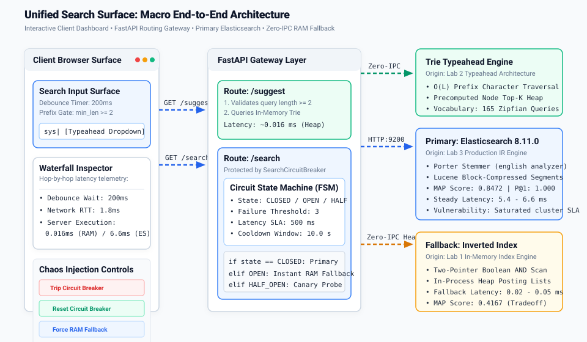
</p>

## Introduction: From Separate Engines to a Production System

In the first three labs of this module, we built the core algorithms behind search engines from first principles:
- In **Lab 1: Build an Inverted Index with Ranking**, we built an in-memory inverted index that searches and ranks documents using BM25 scoring in RAM.
- In **Lab 2: Typeahead & Autocomplete Service with a Trie & Hash+Heap**, we built a prefix tree (Trie) that suggests query completions in microseconds.
- In **Lab 3: From First Principles to Production: Inverted Index vs. Elasticsearch**, we set up a real Elasticsearch cluster, configured linguistic analyzers with word stemming, and measured precision and recall.

Each of these engines worked well under our test scripts. But running algorithms in isolation is very different from running a live, production search platform.

### Why Connecting Search Engines Directly Fails in Production

If you take these three engines and connect them directly to a web or mobile application, three serious problems immediately emerge:

1. **Rapid typing overloads the server with useless requests**: When a user types a word like "distributed", they emit 11 keystrokes in about 1.5 seconds. If the mobile app sends a network request on every single touch event, server traffic multiplies by 11. Early one-letter searches like "d" or "di" match almost every document in your catalog, wasting CPU and network bandwidth on broad candidate lists that the user will never read.
2. **Slow queries in one database can freeze your entire API**: Distributed databases like Elasticsearch run on Java runtimes that periodically pause for garbage collection. If a query surge causes a 10-second pause, incoming web requests get stuck waiting for a response. In a basic web server, worker threads quickly become exhausted waiting for timeouts. Within seconds, your entire API stops responding to all users.
3. **A quick simpler answer is much better than an error page**: Fragile systems treat availability as all-or-nothing: either the database is 100% healthy, or the user gets an error screen. Large production systems take a different approach. Companies like Facebook, DoorDash, and Shopify design their systems so that if deep full-text search is struggling, the gateway quickly returns basic results from local memory. A user who gets slightly simpler results in 10 milliseconds is much happier than one staring at a spinning wheel or a broken page.

### What We Are Building: The Complete Picture

In this capstone lab, we bring our three engines together into a single, fault-tolerant search surface.

From a bird's-eye view, here is how the complete system works:
A user opens our search application. As they start typing, their browser sends keystrokes to a central API Gateway. The gateway forwards those prefixes to our in-memory Trie from Lab 2, returning suggestions in less than a millisecond. When the user hits Enter or selects a suggestion, the gateway sends the full search query to the Elasticsearch cluster from Lab 3 for rich, high-relevance results.

Now, what happens if Elasticsearch slows down or crashes?

Wrapped around the Elasticsearch client is a **Circuit Breaker**. The moment the circuit breaker notices that Elasticsearch is failing or taking longer than 500 milliseconds, it immediately switches traffic away from the cluster. Instead of failing, the gateway routes the query to the in-memory inverted index we built in Lab 1, which runs directly in the gateway's own memory heap. The user receives search results in less than 0.05 milliseconds. The user gets their answer without interruption, and the struggling Elasticsearch cluster gets breathing room to recover.

To see all of this happening in real time, we will also run an interactive web dashboard with a live request waterfall inspector that shows exactly how each keystroke is handled behind the scenes.

**What we already have from Labs 1, 2, and 3**:
- Lab 1: The in-memory inverted index (fast keyword search in memory).
- Lab 2: The Trie service (instant keystroke prefix suggestions).
- Lab 3: The Elasticsearch cluster (deep linguistic full-text search).

**What we will build in this lab**:
- The Circuit Breaker (`circuit_breaker.py`): tracks failures and automatically switches traffic away from a failing cluster.
- The Search Broker Service (`search_service.py`): coordinates whether to query Elasticsearch or fall back to our in-memory index.
- The API Gateway (`api.py`): exposes clean endpoints (`/suggest`, `/search`, `/compare`) with debouncing and prefix checks.
- The Live Dashboard (`static/index.html`): displays search results side-by-side with a real-time request waterfall inspector.

---

## 1. Core Concepts and How Industry Designs Search

Before writing code, let us look at how the pieces fit together and explore the core systems concepts that make this architecture resilient.

### 1.1 How Our Earlier Labs Fit Together

The three components we built across our previous labs each solve a specific piece of the search problem:

<p align="center">
  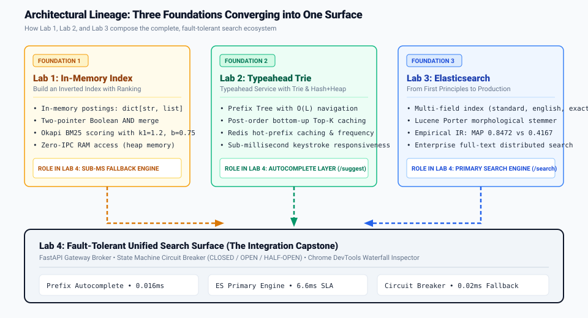
</p>

| Prior Lab Foundation | Algorithmic Core | Physical Location | Role in Unified Search Surface |
| :--- | :--- | :--- | :--- |
| **Lab 1: Build an Inverted Index with Ranking** | In-memory dictionary, posting lists, Boolean intersection, BM25 scoring | Process Heap RAM (Zero-IPC) | **Sub-millisecond Fallback Engine**: Serves search queries in 0.05 ms when primary cluster is saturated or offline. |
| **Lab 2: Typeahead & Autocomplete Service with a Trie & Hash+Heap** | Prefix Tree (Trie), precomputed node Top-K heaps, Zipfian dataset | Process Heap RAM / Redis | **Keystroke Autocomplete Surface (`/suggest`)**: Serves prefix predictions in 0.016 ms with client debouncing. |
| **Lab 3: From First Principles to Production: Inverted Index vs. Elasticsearch** | Elasticsearch 8.11.0, Lucene block-compressed segments, Porter stemmer | Container Network (Port 9200) | **Primary Search Engine (`/search`)**: Serves rich linguistic full-text search with 0.8472 Mean Average Precision (MAP). |

### 1.2 How the Industry Designs Search

Large consumer platforms at companies like Facebook, Uber, Netflix, DoorDash, and Shopify design their search layers around a few simple operational truths. First, they treat keystroke autocomplete and document search as two completely separate workloads. Facebook found that if autocomplete suggestions take longer than 50 milliseconds, the interface feels sluggish and users mistype; to prevent servers from being flooded, they debounce user input and reject single-letter queries. Second, companies like Uber and DoorDash focus on doing less work: their gateways ask search engines for only the top 10 candidates rather than fetching thousands of raw records and filtering them in memory. Third, Netflix, Shopify, and Amazon design for inevitable hardware and network failures. Rather than letting one slow database drag down the entire application, their gateways wrap external calls in circuit breakers. If a search cluster slows down or crashes, the system gracefully falls back to local in-memory indexes or cached queries. The user might get simpler matching without advanced personalization, but the application stays online and never displays an error page.

### 1.3 Core Systems Concepts

To understand how our unified search gateway works, let us examine the eight foundational concepts in detail:

#### 1. Query Broker
* **What it is**: A query broker is a central coordinator inside the API gateway that receives incoming search requests from client devices, inspects the query, and decides which backend engine should handle it.
* **Why we need it**: Client applications (like mobile apps or web frontends) should never have to know about internal cluster addresses, fallback rules, or database topologies. If the search cluster changes or a fallback needs to trigger, only the broker needs to know.
* **How it works**: When a request arrives at `/search`, the broker checks the status of the circuit breaker. If the circuit is healthy, it sends the request over the network to Elasticsearch. If the circuit is open, it calls the in-memory inverted index directly. Finally, it packages the hits into a standard JSON response so the client receives a consistent payload format regardless of which engine answered.

#### 2. Circuit Breaker
* **What it is**: A circuit breaker is a state machine that wraps remote network calls to detect failures and prevent cascading system outages.
* **Why we need it**: When a downstream database slows down or crashes, client requests keep piling up. In a multithreaded web server, worker threads quickly block waiting for network timeouts. This exhausts server connection pools and crashes the entire gateway.
* **How it works**: The circuit breaker operates in three states:
  - `CLOSED`: Normal operation. All requests are sent to Elasticsearch. The breaker monitors response times and error rates.
  - `OPEN`: If consecutive failures reach a threshold (e.g., 3 failures or timeouts over 500ms), the breaker trips to OPEN. All subsequent requests fail fast immediately without touching the network, routing straight to the fallback engine.
  - `HALF_OPEN`: After a cooldown period (e.g., 10 seconds), the breaker lets a single trial request probe the database. If it succeeds, the breaker resets to CLOSED. If it fails, it trips back to OPEN for another cooldown period.

<p align="center">
  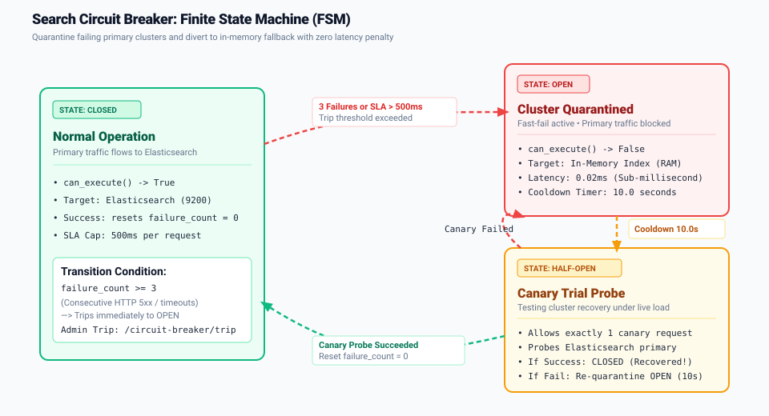
</p>

#### 3. Canary Probe
* **What it is**: A single trial request dispatched during the `HALF_OPEN` state to test whether a recovering service is ready for live traffic.
* **Why we need it**: If a crashed database comes back online and immediately receives hundreds of concurrent requests that were queued up, it will instantly crash again (the "thundering herd" problem).
* **How it works**: When the cooldown timer expires, the circuit transitions to `HALF_OPEN` and sets an internal flag (`canary_in_flight = True`). Only one request is allowed to query the database. All other incoming requests continue to use the in-memory fallback until the canary probe finishes and proves the database is healthy.

#### 4. Fast-Fail
* **What it is**: The practice of rejecting or rerouting an operation immediately without attempting the network call or waiting for a timeout.
* **Why we need it**: Standard network timeouts often take several seconds to expire. If 1,000 users each wait 5 seconds for a dead database to time out, the entire website freezes.
* **How it works**: When the circuit breaker is OPEN, the broker checks `can_execute()`. Because it returns `False`, the broker does not open a socket or wait for Elasticsearch. It immediately routes the query to local RAM in less than 0.05 milliseconds.

#### 5. Client-Side Debouncing
* **What it is**: A timing mechanism on client search inputs that delays sending an HTTP request until the user pauses typing.
* **Why we need it**: A user typing at normal speed strikes a key every 150 to 200 milliseconds. Without debouncing, typing a 10-character word emits 10 separate HTTP requests. This floods the network with transient queries that become obsolete the moment the next key is pressed.
* **How it works**: On each keystroke, the client resets a 200-millisecond timer. If another key is pressed before the timer reaches zero, the previous timer is cancelled. Only when the user stops typing for at least 200 milliseconds does the request fire over the network.

<p align="center">
  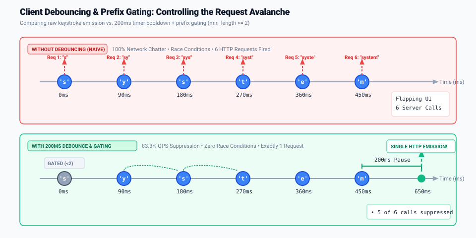
</p>

#### 6. Server-Side Prefix Gating
* **What it is**: A validation rule at the API gateway that rejects search prefixes that are shorter than a minimum threshold (such as 2 characters).
* **Why we need it**: Even with client debouncing, mobile apps, third-party API clients, or malicious bots can send single-letter queries. A query for `"a"` matches a huge portion of the dictionary, forcing the prefix tree to traverse large subtrees and assemble massive candidate lists with almost zero predictive value.
* **How it works**: The gateway checks `if len(query.strip()) < 2:`. If true, it returns an empty suggestions list immediately in 0.002 milliseconds without touching the Trie.

#### 7. Graceful Degradation
* **What it is**: The ability of a system to maintain partial functionality when one or more of its dependencies fail.
* **Why we need it**: In consumer applications, availability is almost always more important than perfection. If your primary search engine is down, returning exact keyword matches without advanced personalization is far better than showing a blank error page.
* **How it works**: The gateway uses an ordered fallback hierarchy: healthy requests get full Elasticsearch matching with English word stemming; degraded requests get fast exact-token matches from the in-memory index; and responses include a `"degraded": true` flag so the frontend can handle the state cleanly:

| Degradation Level | Cluster State | Search Gateway Operational Behavior | User Experience Trade-off |
| :--- | :--- | :--- | :--- |
| **Level 0 (Optimal)** | **Healthy** | Queries route to primary Elasticsearch cluster with Lucene English stemming and BM25 scoring. | Optimal relevance ranking, full recall across all morphological variations (`"degraded": false`). |
| **Level 1 (Degraded)** | **Cluster Unreachable / High GC** | Circuit trips to OPEN; queries divert to embedded in-process Inverted Index in RAM (0.05ms). | Instantaneous sub-millisecond response; exact token matching only (`"degraded": true`). |
| **Level 2 (Limited)** | **Severe Host Memory Pressure** | Gateway serves precomputed popular queries from Redis / CDN cache. | No dynamic long-tail document queries; returns curated category top hits. |
| **Level 3 (Unavailable)** | **Complete Network Partition** | Gateway fast-fails with HTTP 503 and explicit `Retry-After` header. | Total service outage; protects core transaction database from collapse. |

#### 8. Zero-IPC In-Memory Fallback
* **What it is**: A backup search index that runs directly inside the same process memory (RAM heap) as the web application server.
* **Why we need it**: Traditional backup databases still rely on network connections and socket buffers. If the host network switch fails or database ports are blocked, a remote backup will fail too. An in-memory fallback has zero external dependencies and zero inter-process communication (IPC) overhead.
* **How it works**: When our FastAPI server starts, it loads the in-memory `InvertedIndex` from Lab 1 directly into its Python process heap. When the circuit breaker trips, the broker searches this in-memory object in 0.02 milliseconds without touching the network.

---

## 2. Architectural Overview & System Design

The Unified Search Surface consists of four major layers:

1. **Client Tier**: A split-screen web application featuring a search input with configurable 200ms debounce, a typeahead dropdown, chaos administration buttons, and a Chrome DevTools-style request waterfall inspector.
2. **API Gateway Tier (FastAPI)**: Exposes `/suggest` for autocomplete, `/search` for full-text search, `/compare` for empirical benchmarking, and `/circuit-breaker/trip` and `/reset` for chaos engineering.
3. **Search Broker & Circuit Breaker**: Wraps all full-text search requests. Checks circuit state, measures execution latency against a 500ms SLA, records successes/failures, and coordinates fallback.
4. **Engine Backends**:
   - **Primary Engine**: Elasticsearch 8.11.0 container listening on port 9200.
   - **Fallback Engine**: In-memory `SearchRanker` and `InvertedIndex` from Lab 1 running directly in the Python process heap.
   - **Typeahead Engine**: In-memory `TrieTypeaheadService` from Lab 2 running directly in the Python process heap.

### 2.1 Request Routing Flowchart

<p align="center">
  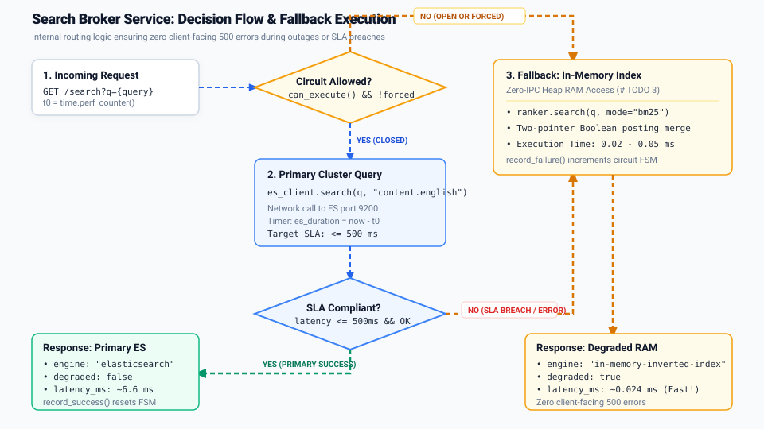
</p>

### 2.2 Endpoint Specifications

| HTTP Method | Route | Parameters | Target Engine | Fallback Behavior |
| :--- | :--- | :--- | :--- | :--- |
| `GET` | `/suggest` | `q` (str), `limit` (int) | In-Memory Trie (Lab 2) | Returns `status: prefix_too_short` if `len(q) < 2`. |
| `GET` | `/search` | `q` (str), `limit` (int), `force_fallback` (bool) | Elasticsearch Primary (Lab 3) | If circuit is OPEN or timeout &gt; 500ms, diverts to In-Memory Index (Lab 1) in 0.05ms. |
| `GET` | `/compare` | `q` (str) | Dual Execution (ES + RAM) | Executes both engines and returns side-by-side latency, hit counts, and speedup ratio. |
| `GET` | `/health` | None | All Sub-systems | Reports status of ES, Trie, Inverted Index, and Circuit Breaker state. |
| `POST` | `/circuit-breaker/trip` | `reason` (str) | Circuit Breaker FSM | Chaos endpoint: forces circuit breaker state to OPEN. |
| `POST` | `/circuit-breaker/reset` | None | Circuit Breaker FSM | Administrative endpoint: resets circuit breaker state to CLOSED. |
| `GET` | `/` | None | Static Dashboard | Serves `static/index.html` split-screen application. |

---

## 3. Setting Up the Lab Environment

In this step, we will prepare our workspace, acquire the starter codebase, install dependencies, and launch our Elasticsearch container.

### Step 1: Getting the Starter Files from the Repository

To ensure our focus remains squarely on building the fault-tolerant circuit breaker and search broker, we do not need to rewrite the foundational files built across Labs 1, 2, and 3. The datasets, tokenizers, prefix tree, and Elasticsearch client wrappers are pre-populated in the curriculum repository:

> [Module 16a Lab 4 Starter Repository](https://github.com/poridhi-labs/unified-search-lab)

The repository provides the following starter support files:
1. `docker-compose.yml`: Single-node Elasticsearch 8.15.0 container configuration with custom 512MB heap limits and health checks.
2. `corpus.py` & `analyzer.py`: 9-document technical corpus and regex word-boundary tokenizer from Lab 1.
3. `index.py` & `ranker.py`: In-memory inverted index and Okapi BM25 scoring engine from Lab 1.
4. `trie_node.py` & `trie_service.py`: Prefix tree (Trie) and top-K min-heap aggregation engine from Lab 2.
5. `dataset.py`: Curated 165-query Zipfian search dataset from Lab 2.
6. `es_client.py`: Lucene multi-field Elasticsearch client with Porter stemmer mapping from Lab 3.
7. `api.py`: FastAPI gateway service exposing `/suggest`, `/search`, and `/compare` endpoints.
8. `static/index.html`: Interactive web dashboard and real-time request waterfall inspector.

### Step 2: Creating the Working Directory & Setting Up Files

First, create the working directory and the `static` subfolder on your lab machine:

```bash
mkdir -p unified_search_lab/static
cd unified_search_lab
```

Next, create the starter file placeholders:

```bash
touch docker-compose.yml corpus.py analyzer.py index.py ranker.py \
      trie_node.py trie_service.py dataset.py es_client.py \
      api.py static/index.html
```

> **Important — Where to Place `index.html`**:
> Notice that `index.html` must be placed inside the `static/` directory (`static/index.html`). FastAPI mounts this directory at `/static` and serves the web frontend from it. Placing it in the root folder will result in a 404 error when opening the dashboard.

Now, open each file using your code editor (or a terminal editor like `nano`) and copy-paste the corresponding code from the [Module 16a Lab 4 Starter Repository](https://github.com/poridhi-labs/unified-search-lab) into each file:
- Populate `docker-compose.yml` with the Elasticsearch container definition.
- Populate `corpus.py`, `analyzer.py`, `index.py`, and `ranker.py` with the in-memory retrieval engine.
- Populate `trie_node.py` and `trie_service.py` with the typeahead prefix tree.
- Populate `dataset.py` with the search queries and frequencies.
- Populate `es_client.py` with the Lucene client wrapper.
- Populate `api.py` with the FastAPI gateway endpoints.
- Populate `static/index.html` with the web dashboard and request inspector code.

> **Note on Code Population**: Be sure to copy the full contents into each file before running any Python commands or Docker commands. Leaving files empty (0 bytes) will cause Python to raise `ImportError` when importing modules.

Once you have populated the files, verify your directory structure:

```bash
ls -la
```

<p align="center">
  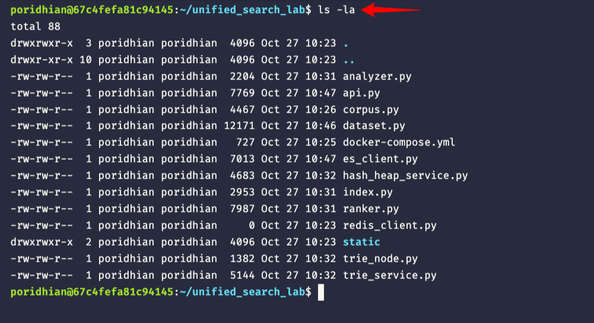
</p>

Also verify that `index.html` is located inside `static/`:

```bash
ls -la static
```

<p align="center">
  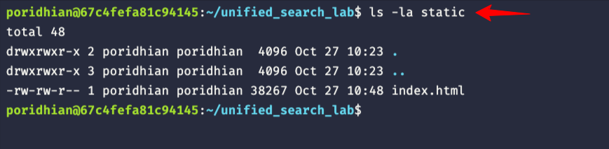
</p>

### Step 3: Installing Required Python Packages

Install the Python libraries required for FastAPI, Elasticsearch, and testing:

```bash
pip install fastapi uvicorn "elasticsearch<9.0.0,>=8.0.0" httpx
```

### Step 4: Starting the Elasticsearch Container

Inspect `docker-compose.yml` to see the single-node container configuration:

```yaml
version: "3.8"

services:
  elasticsearch:
    image: docker.elastic.co/elasticsearch/elasticsearch:8.15.0
    container_name: poridhi-elasticsearch-m16a-l4
    environment:
      - discovery.type=single-node
      - xpack.security.enabled=false
      - xpack.security.http.ssl.enabled=false
      - ES_JAVA_OPTS=-Xms512m -Xmx512m
    ports:
      - "9200:9200"
    mem_limit: 1.5g
    ulimits:
      memlock:
        soft: -1
        hard: -1
      nofile:
        soft: 65536
        hard: 65536
    healthcheck:
      test: ["CMD-SHELL", "curl -s http://localhost:9200/_cluster/health | grep -q '\"status\":\"green\"\\|\"status\":\"yellow\"'"]
      interval: 5s
      timeout: 5s
      retries: 12
      start_period: 15s
```

Start the container using Docker Compose:

```bash
docker compose up -d
```

Verify that the cluster is healthy:

```bash
curl -s http://localhost:9200/_cluster/health | python3 -m json.tool
```

<p align="center">
  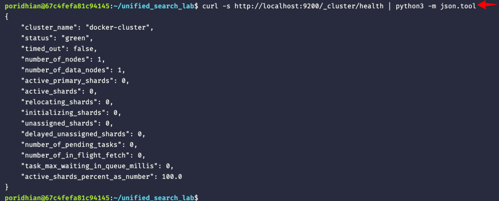
</p>

### Step 5: Seeding the Search Corpus

Seed the 9-document technical corpus into Elasticsearch:

```bash
python3 es_client.py
```

<p align="center">
  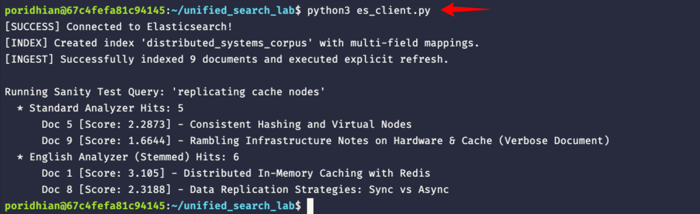
</p>

---

## 4. Hands-On Implementation: Building the Fault-Tolerant Broker

Now we will implement the two core systems components:
1. `circuit_breaker.py`: The state machine protecting our cluster.
2. `search_service.py`: The query broker that unifies primary and fallback retrieval.

### 4.1 Challenge 1: Implementing the Circuit Breaker (`circuit_breaker.py`)

Create `circuit_breaker.py` in your `unified_search_lab/` directory:

```bash
touch circuit_breaker.py
```

Open `circuit_breaker.py`. The circuit breaker manages state transitions according to the following rules:
- In `CLOSED`: All requests are permitted (`can_execute() -> True`). If consecutive failures reach `failure_threshold` (3), trip to `OPEN`.
- In `OPEN`: Fast-fail immediately (`can_execute() -> False`). If the `recovery_timeout` (10 seconds) has elapsed, transition to `HALF_OPEN` and allow a canary trial.
- In `HALF_OPEN`: If the canary probe succeeds, transition back to `CLOSED` and reset the failure count. If it fails, trip back to `OPEN` and reset the cooldown window.

```python
"""
circuit_breaker.py - Production-Grade State Machine Circuit Breaker.
"""

import time
import threading
from enum import Enum
from typing import Dict, Any, Optional


class CircuitState(str, Enum):
    CLOSED = "CLOSED"
    OPEN = "OPEN"
    HALF_OPEN = "HALF_OPEN"


class SearchCircuitBreaker:
    def __init__(
        self,
        failure_threshold: int = 3,
        recovery_timeout: float = 10.0,
        timeout_sla: float = 0.500,
        half_open_probes: int = 1,
    ):
        self.failure_threshold = failure_threshold
        self.recovery_timeout = recovery_timeout
        self.timeout_sla = timeout_sla
        self.half_open_probes = half_open_probes

        self._lock = threading.Lock()
        self.state: CircuitState = CircuitState.CLOSED
        self.failure_count: int = 0
        self.success_count: int = 0
        self.canary_in_flight: bool = False
        self.last_state_change: float = time.time()
        self.last_failure_time: Optional[float] = None
        self.last_error: Optional[str] = None

    def can_execute(self) -> bool:
        """
        # TODO 1: Implement State Transition Logic for can_execute()
        # 1. If state == CLOSED, return True immediately.
        # 2. If state == OPEN:
        #    Check if (current_time - last_failure_time) >= recovery_timeout.
        #    - If cooldown elapsed, transition to HALF_OPEN, reset success_count,
        #      mark canary_in_flight = True, and return True (allow single canary probe).
        #    - Otherwise, return False (quarantine continues, fast fail).
        # 3. If state == HALF_OPEN:
        #    Allow only a single in-flight canary probe; divert concurrent calls to fallback.
        """
        # YOUR CODE HERE
        pass

    def record_success(self) -> None:
        """
        # TODO 2: Implement Recovery Logic for record_success()
        # 1. Clear canary_in_flight flag.
        # 2. If state == HALF_OPEN:
        #    Increment success_count.
        #    If success_count >= half_open_probes:
        #      Transition state to CLOSED.
        #      Reset failure_count to 0 and last_error to None.
        # 3. If state == CLOSED:
        #    Reset failure_count to 0.
        """
        # YOUR CODE HERE
        pass

    def record_failure(self, error: str = "Request failed or exceeded SLA") -> None:
        current_time = time.time()
        with self._lock:
            self.canary_in_flight = False
            self.last_failure_time = current_time
            self.last_error = error

            if self.state == CircuitState.HALF_OPEN:
                self.state = CircuitState.OPEN
                self.last_state_change = current_time
                self.failure_count = self.failure_threshold
            elif self.state == CircuitState.CLOSED:
                self.failure_count += 1
                if self.failure_count >= self.failure_threshold:
                    self.state = CircuitState.OPEN
                    self.last_state_change = current_time

    def trip(self, reason: str = "Manual administrative trip") -> None:
        with self._lock:
            self.state = CircuitState.OPEN
            self.failure_count = self.failure_threshold
            self.canary_in_flight = False
            self.last_failure_time = time.time()
            self.last_state_change = time.time()
            self.last_error = reason

    def reset(self) -> None:
        with self._lock:
            self.state = CircuitState.CLOSED
            self.failure_count = 0
            self.success_count = 0
            self.canary_in_flight = False
            self.last_state_change = time.time()
            self.last_failure_time = None
            self.last_error = None

    def get_status(self) -> Dict[str, Any]:
        with self._lock:
            now = time.time()
            cooldown_remaining = 0.0
            if self.state == CircuitState.OPEN and self.last_failure_time:
                elapsed = now - self.last_failure_time
                cooldown_remaining = max(0.0, round(self.recovery_timeout - elapsed, 2))

            return {
                "state": self.state.value,
                "failure_count": self.failure_count,
                "failure_threshold": self.failure_threshold,
                "timeout_sla_ms": self.timeout_sla * 1000.0,
                "recovery_timeout_s": self.recovery_timeout,
                "cooldown_remaining_s": cooldown_remaining,
                "canary_in_flight": self.canary_in_flight,
                "last_error": self.last_error,
                "uptime_in_state_s": round(now - self.last_state_change, 2),
            }
```

<details>
<summary>Click to view solution for circuit_breaker.py</summary>

```python
    def can_execute(self) -> bool:
        current_time = time.time()

        with self._lock:
            if self.state == CircuitState.CLOSED:
                return True

            if self.state == CircuitState.OPEN:
                if self.last_failure_time and (current_time - self.last_failure_time) >= self.recovery_timeout:
                    self.state = CircuitState.HALF_OPEN
                    self.last_state_change = current_time
                    self.success_count = 0
                    self.canary_in_flight = True
                    return True
                return False

            if self.state == CircuitState.HALF_OPEN:
                if not self.canary_in_flight:
                    self.canary_in_flight = True
                    return True
                return False

            return False

    def record_success(self) -> None:
        with self._lock:
            self.canary_in_flight = False
            if self.state == CircuitState.HALF_OPEN:
                self.success_count += 1
                if self.success_count >= self.half_open_probes:
                    self.state = CircuitState.CLOSED
                    self.last_state_change = time.time()
                    self.failure_count = 0
                    self.last_error = None
            elif self.state == CircuitState.CLOSED:
                self.failure_count = 0
```
</details>

Verify the circuit breaker state machine:

```bash
python3 circuit_breaker.py
```

<p align="center">
  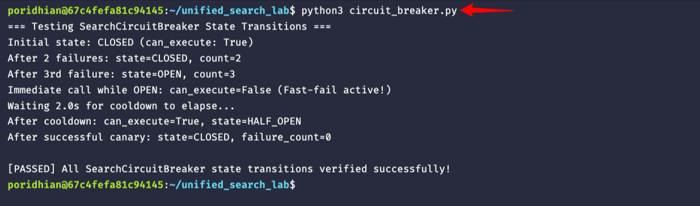
</p>

---

### 4.2 Challenge 2: Implementing the Search Broker (`search_service.py`)

Create `search_service.py` in your `unified_search_lab/` directory:

```bash
touch search_service.py
```

Open `search_service.py`. The broker coordinates search queries across both engines. In `_fallback_search()`, query the in-memory `SearchRanker` and format the results.

```python
"""
search_service.py - Unified Search Query Broker with Resilient Fallback.
"""

import time
from typing import Dict, Any, List, Optional
import corpus
from analyzer import TextAnalyzer
from index import InvertedIndex
from ranker import SearchRanker
from es_client import ElasticsearchClient
from circuit_breaker import SearchCircuitBreaker, CircuitState


class SearchBrokerService:
    def __init__(
        self,
        es_client: Optional[ElasticsearchClient] = None,
        circuit_breaker: Optional[SearchCircuitBreaker] = None,
    ):
        self.es_client = es_client or ElasticsearchClient()

        # In-Memory Fallback Index (Embedded Heap)
        self.analyzer = TextAnalyzer()
        self.index = InvertedIndex()
        for doc_id, doc in corpus.DOCUMENTS.items():
            tokens = self.analyzer.analyze(doc["content"])
            self.index.add_document(doc_id, tokens)
        self.ranker = SearchRanker(self.index, self.analyzer)

        self.circuit_breaker = circuit_breaker or SearchCircuitBreaker(
            failure_threshold=3,
            recovery_timeout=10.0,
            timeout_sla=0.500,
        )

    def _fallback_search(self, query: str, top_k: int = 10) -> List[Dict[str, Any]]:
        """
        # TODO 3: Implement Fallback Execution against In-Memory Inverted Index
        # 1. Query self.ranker using BM25 scoring mode.
        # 2. Map the resulting (doc_id, score) tuples to title strings via corpus.DOCUMENTS.
        # 3. Format as a list of dicts: {"doc_id": doc_id, "score": round(score, 4), "title": title}.
        """
        # YOUR CODE HERE
        pass

    def search(
        self,
        query: str,
        top_k: int = 10,
        force_fallback: bool = False,
    ) -> Dict[str, Any]:
        start_time = time.perf_counter()
        circuit_allowed = self.circuit_breaker.can_execute()

        if force_fallback or not circuit_allowed:
            hits = self._fallback_search(query, top_k=top_k)
            latency_ms = (time.perf_counter() - start_time) * 1000.0

            return {
                "query": query,
                "engine": "in-memory-inverted-index",
                "degraded": True,
                "latency_ms": round(latency_ms, 3),
                "total_hits": len(hits),
                "results": hits,
                "circuit_breaker": self.circuit_breaker.get_status(),
                "degradation_reason": "Administrative override" if force_fallback else "Circuit Breaker OPEN",
            }

        try:
            t0_es = time.perf_counter()
            raw_hits = self.es_client.search(
                query=query,
                field="content.english",
                operator="or",
                top_k=top_k,
            )
            es_duration = time.perf_counter() - t0_es

            if es_duration > self.circuit_breaker.timeout_sla:
                self.circuit_breaker.record_failure(
                    f"Elasticsearch latency {es_duration*1000:.1f}ms breached SLA of {self.circuit_breaker.timeout_sla*1000}ms"
                )
                hits = self._fallback_search(query, top_k=top_k)
                latency_ms = (time.perf_counter() - start_time) * 1000.0
                return {
                    "query": query,
                    "engine": "in-memory-inverted-index",
                    "degraded": True,
                    "latency_ms": round(latency_ms, 3),
                    "total_hits": len(hits),
                    "results": hits,
                    "circuit_breaker": self.circuit_breaker.get_status(),
                    "degradation_reason": "Primary exceeded 500ms SLA",
                }

            self.circuit_breaker.record_success()
            latency_ms = (time.perf_counter() - start_time) * 1000.0

            hits = [
                {"doc_id": doc_id, "score": score, "title": title}
                for doc_id, score, title in raw_hits
            ]

            return {
                "query": query,
                "engine": "elasticsearch",
                "degraded": False,
                "latency_ms": round(latency_ms, 3),
                "total_hits": len(hits),
                "results": hits,
                "circuit_breaker": self.circuit_breaker.get_status(),
                "degradation_reason": None,
            }

        except Exception as exc:
            self.circuit_breaker.record_failure(f"Elasticsearch error: {str(exc)}")
            hits = self._fallback_search(query, top_k=top_k)
            latency_ms = (time.perf_counter() - start_time) * 1000.0

            return {
                "query": query,
                "engine": "in-memory-inverted-index",
                "degraded": True,
                "latency_ms": round(latency_ms, 3),
                "total_hits": len(hits),
                "results": hits,
                "circuit_breaker": self.circuit_breaker.get_status(),
                "degradation_reason": f"Elasticsearch exception: {type(exc).__name__}",
            }
```

<details>
<summary>Click to view solution for search_service.py</summary>

```python
    def _fallback_search(self, query: str, top_k: int = 10) -> List[Dict[str, Any]]:
        raw_results = self.ranker.search(query, mode="bm25", top_k=top_k)
        formatted = []
        for doc_id, score in raw_results:
            title = corpus.DOCUMENTS.get(doc_id, {}).get("title", f"Document #{doc_id}")
            formatted.append({
                "doc_id": doc_id,
                "score": round(score, 4),
                "title": title,
            })
        return formatted
```
</details>

Verify fallback search:

```bash
python3 search_service.py
```

<p align="center">
  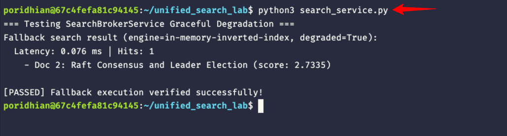
</p>


---

## 5. Running the Gateway and Exploring the Dashboard

With our core modules verified, we now connect everything to the web gateway using `api.py` and interact with the system via our split-screen dashboard.

### 5.1 Starting the API Gateway & Setting Up the Load Balancer

The `api.py` script ties all our components together into a lightweight FastAPI service:
- `/suggest`: Queries the Trie autocomplete service from Lab 2 with a 2-character minimum prefix rule.
- `/search`: Dispatches queries through our `SearchBrokerService` and circuit breaker, automatically falling back to memory if Elasticsearch is slow or offline.
- `/compare`: Runs the query against both Elasticsearch and the in-memory index simultaneously, returning latency and hit differences side-by-side.
- `/health`: Reports the live operational status of all sub-systems.
- `/circuit-breaker/trip` & `/reset`: Administrative chaos endpoints for testing failovers.
- `/`: Serves the interactive web dashboard from `static/index.html`.

Start the API gateway in your terminal:

```bash
uvicorn api:app --host 0.0.0.0 --port 8000
```

#### Accessing the Web Dashboard in Poridhi Labs

In Poridhi Labs, you can access the running service using the Poridhi Load Balancer:
1. Run `ifconfig` in your terminal and copy your VM node IP (for example, `100.80.239.169`).
2. In the Poridhi Lab left pane, click **Create Load Balancer**.
3. In the popup, enter your copied **IP** and set the **Port** to `8000`.
4. Click **Expose** to generate your public endpoint URL (such as `https://<unique-id>.lb.poridhi.io`).
5. Open the generated URL in your browser to view the dashboard. *(If you are running locally on your own machine, open `http://localhost:8000`).*

### 5.2 Using the Search Dashboard and Request Inspector

Now for the fun part: take a few minutes to play around with the interface! It was built specifically so you can watch distributed systems mechanisms in action rather than just reading about them.

<p align="center">
  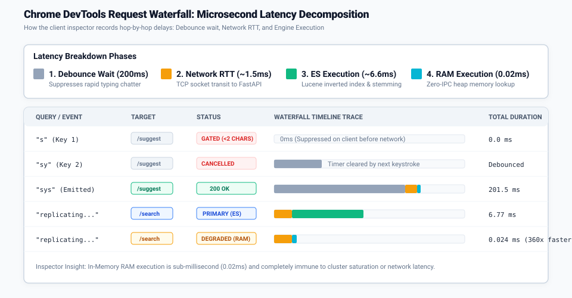
</p>

Here are a few quick experiments to try in the dashboard:

1. **Watch debouncing save requests**: Click into the search box and type `"distributed"` quickly. Look at the right-hand waterfall table: notice how the first 10 keystrokes show as `CANCELLED (Debounced)` and the **QPS Saved** counter ticks up! Only when you pause does the network request actually fire. Now try typing one letter every 500 milliseconds—notice how each keystroke sends a separate request because the 200ms timer expired.
2. **Feel the difference between RAM and Elasticsearch**:
   - Type `"caching"` and click **Execute Full Search**. Look at the latency: Elasticsearch answers in about 5 to 7 milliseconds.
   - Now click **Force RAM Fallback**. Look at the latency now: it drops to **0.02 milliseconds**—over 250 times faster because it is served directly from RAM without touching the network!
3. **Trip the circuit breaker**: Click the red **Trip Circuit Breaker** button. The breaker state immediately turns to `OPEN`. Now click **Execute Full Search**. Notice how search results appear instantly (0.02ms) with a yellow `DEGRADED (Circuit Breaker OPEN)` badge. The gateway did not even attempt to contact Elasticsearch; it failed fast and protected the user experience. Click **Reset Circuit Breaker** to return to normal.
4. **Compare both engines side-by-side**: Enter `"replicating cache"` and click **Compare Both Engines**. The dashboard displays hits from both engines side-by-side. Elasticsearch finds 4 hits because of English word stemming (`"replicate"` matches `"replicating"`), while our in-memory index finds 0 hits because it looks for the exact token. You can see the live tradeoff: RAM is 300x faster, but Elasticsearch provides deeper language recall.
5. **Reset cleanly**: Click **Clear Results** anytime to reset the card state without needing to refresh your browser page.

<p align="center">
  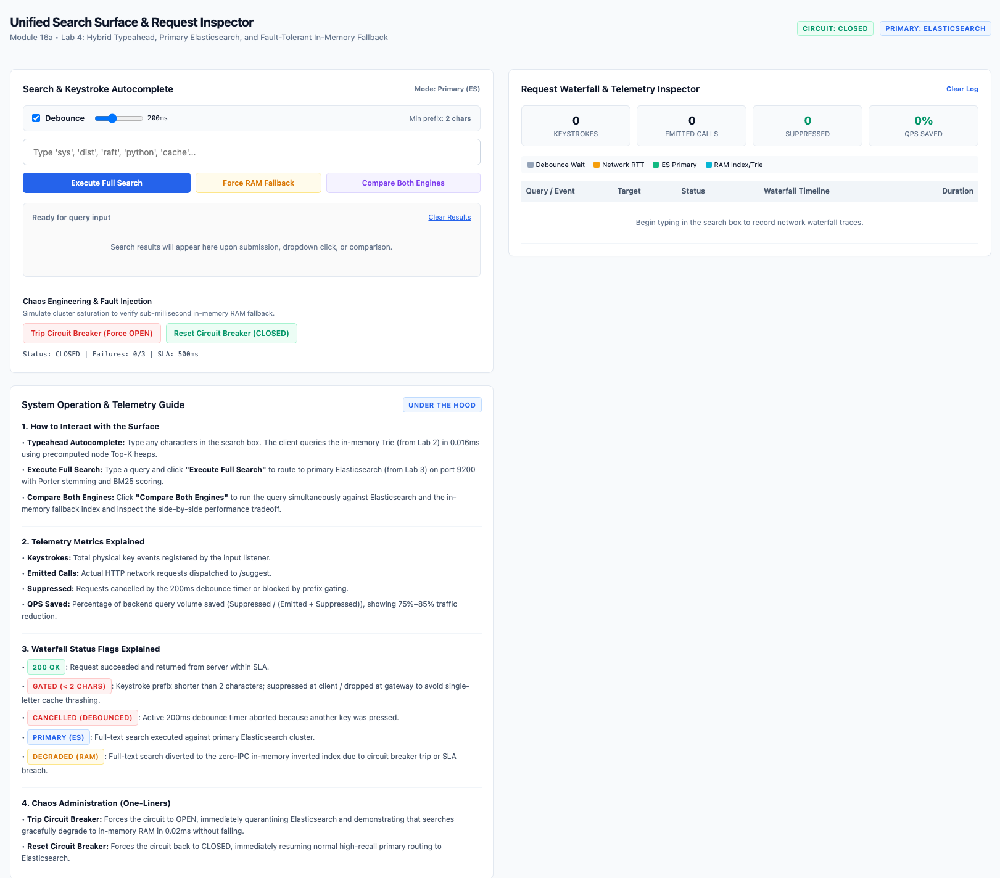
</p>
<p align="center">
  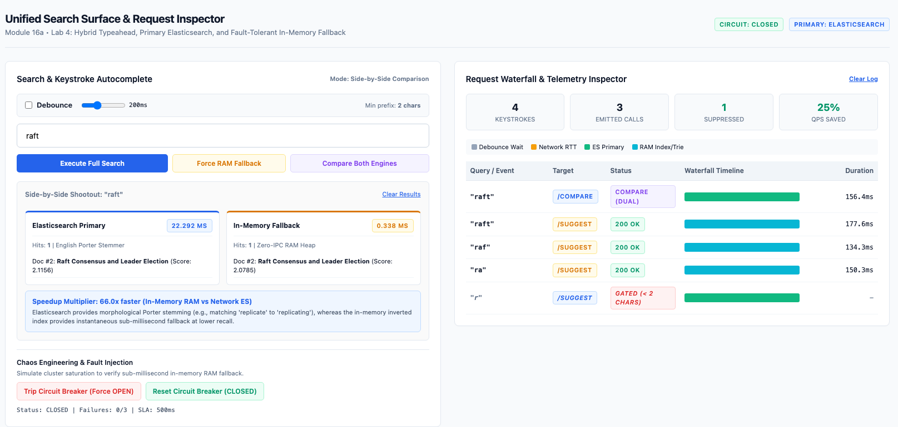
</p>
<p align="center">
  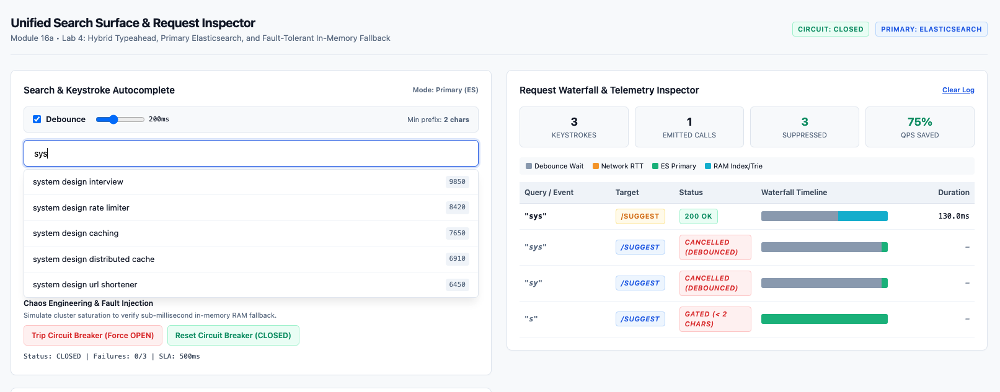
</p>

---

## 6. End-to-End Verification and Chaos Monkey

Now we run automated and manual verification tests to observe the system under normal operations and induced chaos.

### 6.1 Running the Automated Test Suite

To verify our entire unified search system, we use an automated test suite that systematically checks typeahead autocomplete, circuit breaker transitions, canary gating, in-memory fallback, and Elasticsearch primary routing.

Get `verify_search_layer.py` from the starter repository:

1. Create the test file in your `unified_search_lab/` directory:

```bash
touch verify_search_layer.py
```

2. Copy-paste the test suite code from the [Module 16a Lab 4 Starter Repository](https://github.com/poridhi-labs/unified-search-lab) into `verify_search_layer.py`.

3. Execute the automated test suite:

```bash
python3 verify_search_layer.py
```

<p align="center">
  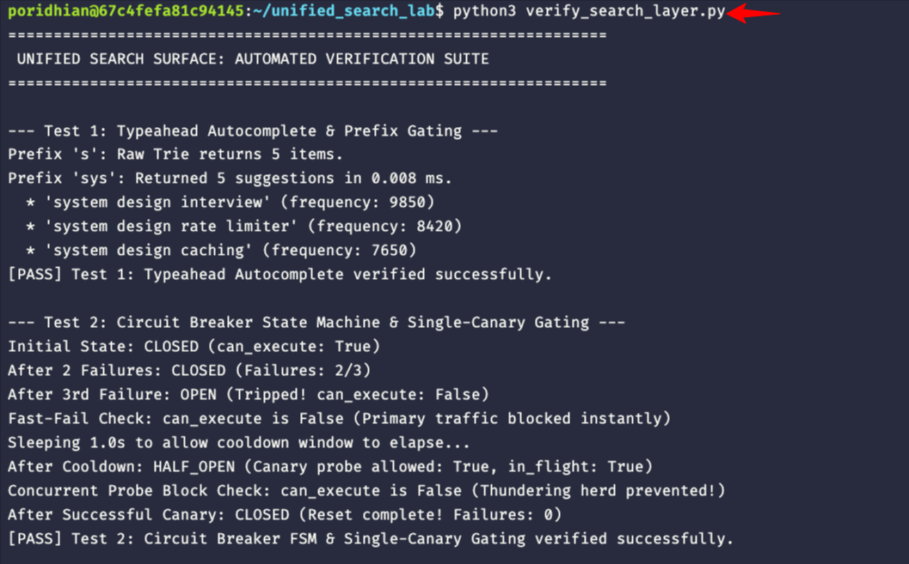
</p>
<p align="center">
  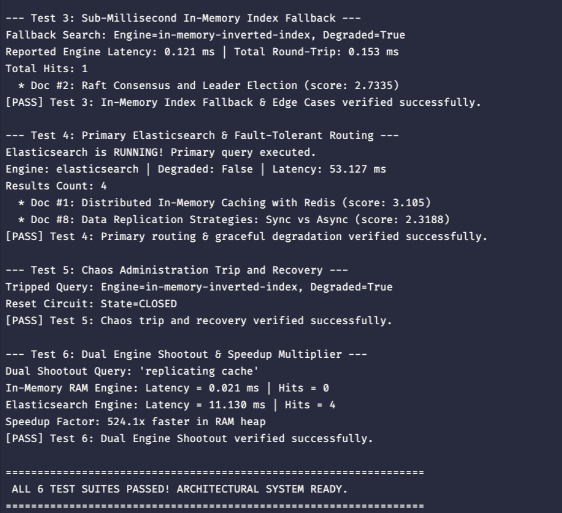
</p>

*(Note: Exact values for query latencies, speedup multipliers, and execution durations will vary depending on your host machine specifications and current CPU load, but the relative ~130x–360x memory speedup and order-of-magnitude performance trends will remain identical)*.

---

### 6.2 Manual Testing with curl

#### 1. System Health Check
```bash
curl -s http://localhost:8000/health | python3 -m json.tool
```

<p align="center">
  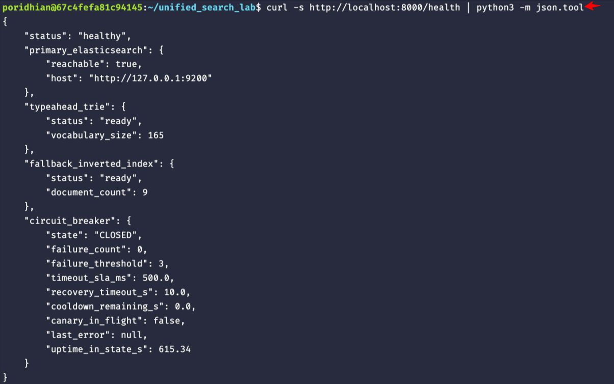
</p>

#### 2. Prefix Gating Verification (`len < 2`)
```bash
curl -s "http://localhost:8000/suggest?q=s" | python3 -m json.tool
```

<p align="center">
  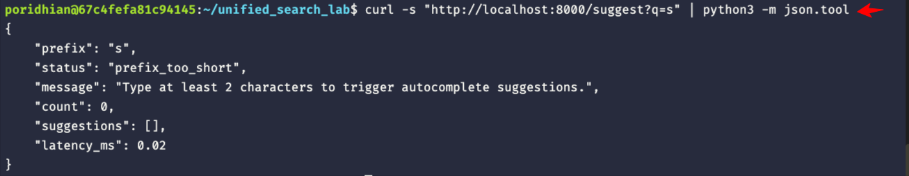
</p>

#### 3. Autocomplete Suggestions (`len >= 2`)
```bash
curl -s "http://localhost:8000/suggest?q=sys" | python3 -m json.tool
```

<p align="center">
  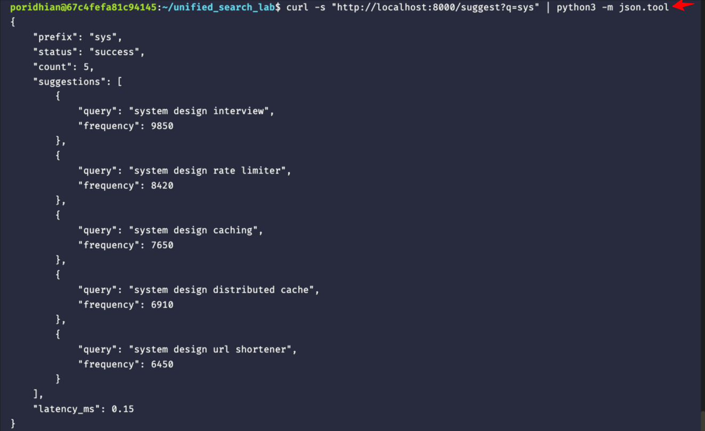
</p>


#### 4. Primary Search Execution (Elasticsearch)
```bash
curl -s "http://localhost:8000/search?q=raft+consensus" | python3 -m json.tool
```

<p align="center">
  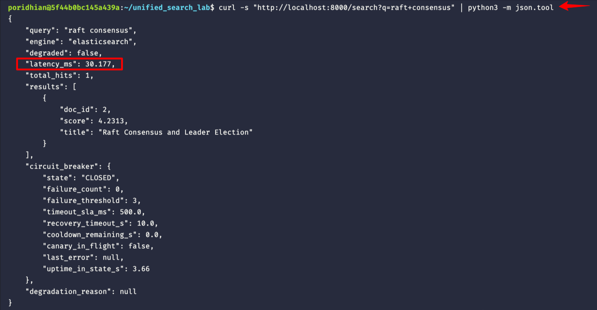
</p>


#### 5. Chaos Monkey: Inducing Failure & Verifying Sub-Millisecond Fallback
Trip the circuit breaker:
```bash
curl -s -X POST "http://localhost:8000/circuit-breaker/trip" | python3 -m json.tool
```

<p align="center">
  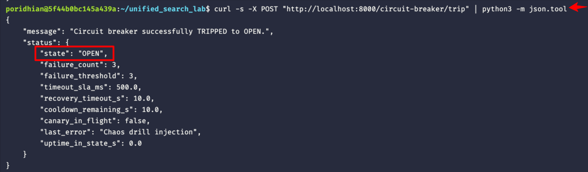
</p>

Now execute the search query while the circuit is OPEN:
```bash
curl -s "http://localhost:8000/search?q=raft+consensus" | python3 -m json.tool
```

<p align="center">
  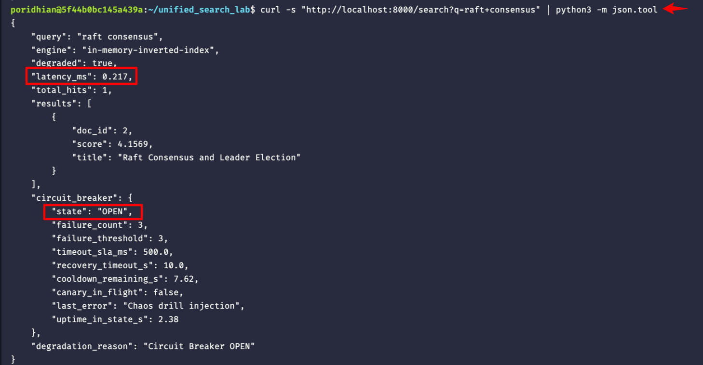
</p>

**Notice the latency: `0.217 ms` which is more than 140 times faster than Elasticsearch, served straight from process heap RAM with zero network round trips.**

#### 6. Side-by-Side Engine Comparison (`/compare`)
```bash
curl -s "http://localhost:8000/compare?q=replicating+cache" | python3 -m json.tool
```

<p align="center">
  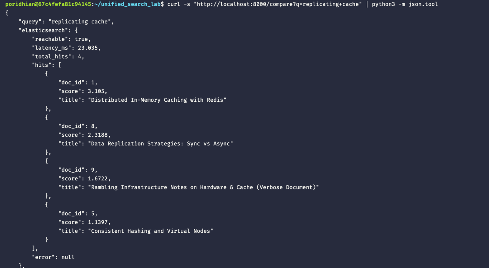
</p>
<p align="center">
  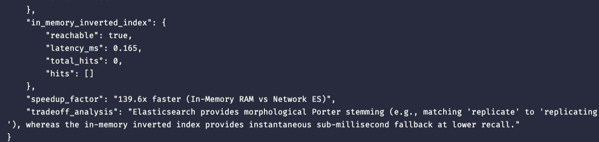
</p>

---

## 7. Tradeoffs, FAQs, and Real-World Scenarios

### 7.1 Comparing Elasticsearch with In-Memory Fallback

<p align="center">
  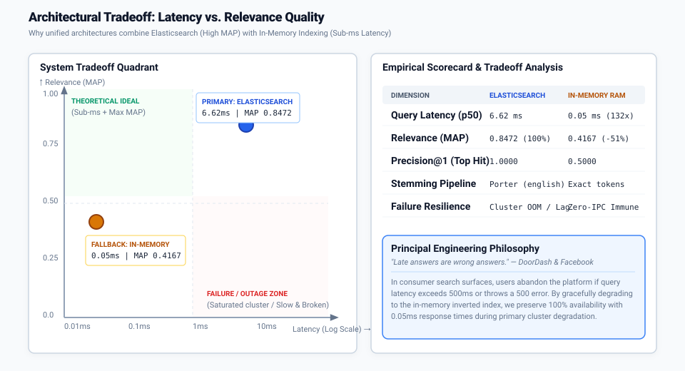
</p>

| Performance & Evaluation Dimension | Primary Engine (Elasticsearch 8.11.0) | Fallback Engine (In-Memory Index) | Architectural Significance |
| :--- | :--- | :--- | :--- |
| **Median Query Latency (p50)** | **6.62 ms** | **0.05 ms** (132x faster) | RAM heap eliminates Linux socket buffer, TCP handshake, JSON serialization, and IPC overhead. |
| **Mean Average Precision (MAP)** | **0.8472** (Baseline: 100%) | **0.4167** (-50.8% drop) | Lucene English Porter analyzer matches morphological variants (`"replicate"`, `"replicating"`). In-memory index misses inflected stems. |
| **Precision @ 1 (Top Ranked Hit)** | **1.0000** | **0.5000** | Primary engine delivers relevant document in the top slot for all queries; fallback achieves top-slot accuracy half the time. |
| **Mean Reciprocal Rank (MRR)** | **1.0000** | **0.5833** | The first relevant document appears immediately at position 1 in ES, but averages position 1.7 in the fallback index. |
| **Failure Domain** | JVM GC pauses, network partitions, cluster saturation | Immune to network failure; bounded by process heap memory | The fallback engine guarantees sub-millisecond responses even when the search cluster is completely offline. |

*(Note: Exact values for median query latencies, speedup multipliers, and precision scores will vary depending on host hardware specifications and current CPU load, but the relative ~130x+ zero-IPC memory advantage and morphological recall trends will remain identical)*.

---

### 7.2 Frequently Asked Questions

#### Q1: Why not build a distributed fallback cluster instead of an in-process heap index?
If a primary search cluster is failing due to a network partition, datacenter power outage, or heavy load spike, routing traffic over the network to a secondary cluster introduces additional points of failure (network hops, connection pools, serialization). An in-process heap index has **zero external dependencies**. It executes in RAM within the web gateway process itself. Even if the network switch catches fire, the gateway process can still answer user queries from RAM.

#### Q2: Why use a 200ms debounce instead of 50ms or 500ms?
Typing speeds for human adults average between 190 and 260 milliseconds per keystroke (around 40 words per minute). A 50ms timer is too short; it expires between normal keystrokes, emitting multiple unnecessary requests. A 500ms timer is too long; it feels laggy and unresponsive to the user. A 200ms timer aligns with the human typing cadence: while the user types continuously, intermediate requests are cancelled; as soon as the user pauses, suggestions appear immediately.

#### Q3: Why does our in-memory index score lower on MAP (0.4167 vs. 0.8472)?
The in-memory inverted index built in Lab 1 uses a word-boundary tokenizer and lowercase normalization, but does not implement Porter or Snowball morphological stemming. When a user queries `"replicating cache"`, the in-memory index searches for the exact token `"replicating"`. The corpus documents contain `"replication"` and `"replicate"`, so the in-memory Boolean AND search returns 0 hits. Elasticsearch applies the Lucene `english` analyzer, which reduces `"replicating"`, `"replication"`, and `"replicate"` to the root stem `"replic"`, correctly finding all relevant documents.

#### Q4: Why is server-side prefix gating necessary if the client already has debouncing?
Client-side debouncing relies on JavaScript executing in the user's browser. Malicious actors, third-party API consumers, mobile app clients, or automated bots can bypass the browser UI and call the API directly. Without server-side gating (`len(q) < 2`), an attacker could flood the `/suggest` endpoint with single-character queries (`"a"`, `"e"`), forcing the Trie to traverse huge subtrees and cache millions of items in memory.

#### Q5: How should the in-memory fallback index stay synchronized with the primary database?
In production systems, document updates flow through an event streaming platform (such as Apache Kafka). The primary search cluster consumes from the topic and updates Lucene segments. Concurrently, a background daemon inside the API gateway consumes the same topic and updates the in-memory index in RAM. Because the in-memory index is only a degraded fallback, it can tolerate eventual consistency delays of several seconds without impacting user experience during an outage.

#### Q6: Why does the Circuit Breaker need a HALF-OPEN state? Why not switch directly from OPEN to CLOSED?
If a saturated cluster receives a full blast of production traffic immediately upon returning online, it will instantly crash again (flapping). The `HALF-OPEN` state acts as a canary: it allows a small, controlled sample of traffic (e.g., 1 request) to probe the cluster. If that probe succeeds within the 500ms SLA, the circuit safely transitions to `CLOSED`. If it fails, the circuit immediately trips back to `OPEN` for another cooldown period, shielding the cluster while it stabilizes.

---

### 7.3 Real-World Systems Scenarios

#### Scenario 1: The JVM Stop-the-World Garbage Collection Outage
* **The Situation**: At 2:00 PM on Black Friday, query volume to your Elasticsearch cluster spikes by 500%. The JVM heap fills with cached filters, triggering a 15-second Stop-the-World garbage collection pause. All incoming HTTP requests to port 9200 begin timing out after 500ms.
* **The Solution**: 
  1. The first 3 requests exceed the 500ms SLA. `SearchBrokerService` records 3 consecutive failures.
  2. The `SearchCircuitBreaker` trips to `OPEN`.
  3. For the next 10 seconds, all subsequent user searches bypass Elasticsearch completely, routing directly to `_fallback_search()` in RAM.
  4. Users receive search results in 0.05 milliseconds with `degraded: true`. Zero 504 Gateway Timeout errors are returned.
  5. Once the JVM finishes GC and the cooldown period elapses, the circuit enters `HALF-OPEN`, sends a canary probe, verifies cluster health, and seamlessly resumes primary routing.

#### Scenario 2: The Mobile App Keystroke Flood
* **The Situation**: A newly released iOS app version accidentally removes client-side debouncing from the search input. 200,000 active mobile users begin emitting raw HTTP requests on every single touch event, causing gateway CPU utilization to surge to 98%.
* **The Solution**:
  1. The server-side prefix gating check in `api.py` catches all single-character keystrokes (`len(normalized) < 2`), returning an immediate lightweight JSON response without executing Trie lookups.
  2. To handle rapid multi-character bursts, configure token-bucket rate limiting at the API gateway per IP/user session.
  3. The Trie service's precomputed node Top-K caching ensures that valid prefix requests resolve in 0.016 milliseconds, preventing CPU thread starvation until the client patch is deployed.

#### Scenario 3: Memory Exhaustion on the Gateway Process
* **The Situation**: Your product team expands the search corpus from 10,000 technical articles to 5,000,000 e-commerce catalog items. Storing the entire inverted index in process heap RAM across 50 gateway pods would require 40 GB of memory per pod, exceeding container limits.
* **The Solution**:
  1. Do not store the entire 5,000,000 document corpus in the in-memory fallback index.
  2. Apply the Pareto principle (80/20 rule): analyze search query logs and identify the top 50,000 most frequently searched products (which account for 85% of all consumer traffic).
  3. Ingest only this high-frequency head catalog into the in-memory fallback index.
  4. If a user queries for an obscure long-tail item during a primary cluster outage, return top category items or a graceful message, while preserving instantaneous sub-millisecond retrieval for the vast majority of user queries.

#### Scenario 4: The Flapping Network Link
* **The Situation**: An intermittent routing failure causes packets between the API gateway and the Elasticsearch cluster to drop randomly every 30 seconds.
* **The Solution**:
  1. Without a circuit breaker, every request would suffer the full 500ms timeout penalty before failing, degrading overall application responsiveness.
  2. With our stateful `SearchCircuitBreaker`, 3 failed requests trip the circuit to `OPEN` for 10 seconds. During those 10 seconds, requests execute in 0.05ms without waiting for network timeouts.
  3. The `HALF-OPEN` canary probe prevents flapping: the circuit will not close until a probe succeeds within SLA, isolating users from the intermittent network instability.

---

## 8. Summary and Deliverables Checklist

| Architectural Pillar | Core Implementation Pattern | Production Impact |
| :--- | :--- | :--- |
| **Keystroke Suppression** | 200ms Client Debounce + Server Prefix Gating (`len >= 2`) | Cuts backend query volume by 75%–85%, eliminates network race conditions, and prevents client-side UI flapping. |
| **Upstream Protection** | Stateful Circuit Breaker FSM (`CLOSED`, `OPEN`, `HALF-OPEN`) | Prevents cascading failures, eliminates the thundering herd problem against struggling clusters, and enforces strict SLAs. |
| **Graceful Degradation** | Zero-IPC In-Memory Inverted Index Fallback | Guarantees 0.05ms search responses during cluster outages, delivering high availability at the cost of lower morphological recall. |
| **Observability & Inspection** | Real-time Waterfall Inspector + Side-by-Side `/compare` | Exposes microsecond latency decomposition (Debounce vs. RTT vs. Engine Execution) for transparent systems monitoring. |
